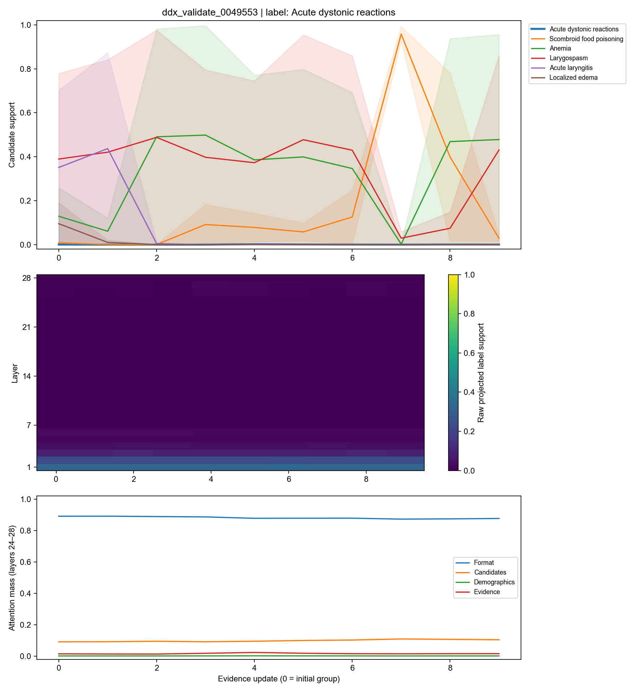

# ddx_validate_0049553

源标签：**Acute dystonic reactions**；参考首位：**Acute dystonic reactions**。

实线为两个编码的平均分，阴影为两编码范围；逐层热图为原始投影，注意力曲线为晚5层均值。终点评价使用三个编码，可能与此处两编码轨迹不同。

| 轮 | 新证据（原始英文） | 当前首选 | 标签支持 |
|---|---|---|---|
| 0 | Do you have a hard time opening/raising one or both eyelids? **Yes** | Larygospasm | 0.0003 |
| 1 | Do you have trouble keeping your tongue in your mouth? **Yes** | Acute laryngitis | 0.0000 |
| 2 | Do you feel that muscle spasms or soreness in your neck are keeping you from turning your head to one side? **Yes** | Anemia | 0.0001 |
| 3 | Do you suddenly have difficulty or an inability to open your mouth or have jaw pain when opening it? **Yes** | Anemia | 0.0000 |
| 4 | Have you started or taken any antipsychotic medication within the last 7 days? **Yes** | Anemia | 0.0020 |
| 5 | Have you ever felt like you were suffocating for a very short time associated with inability to breathe or speak? **Yes** | Larygospasm | 0.0009 |
| 6 | Have you traveled out of the country in the last 4 weeks? **No** | Larygospasm | 0.0004 |
| 7 | Do you have annoying muscle spasms in your face, neck or any other part of your body? **Yes** | Scombroid food poisoning | 0.0000 |
| 8 | Have you been treated in hospital recently for nausea, agitation, intoxication or aggressive behavior and received medication via an intravenous or intramuscular route? **Yes** | Anemia | 0.0007 |
| 9 | Are you experiencing shortness of breath or difficulty breathing in a significant way? **Yes** | Anemia | 0.0004 |
