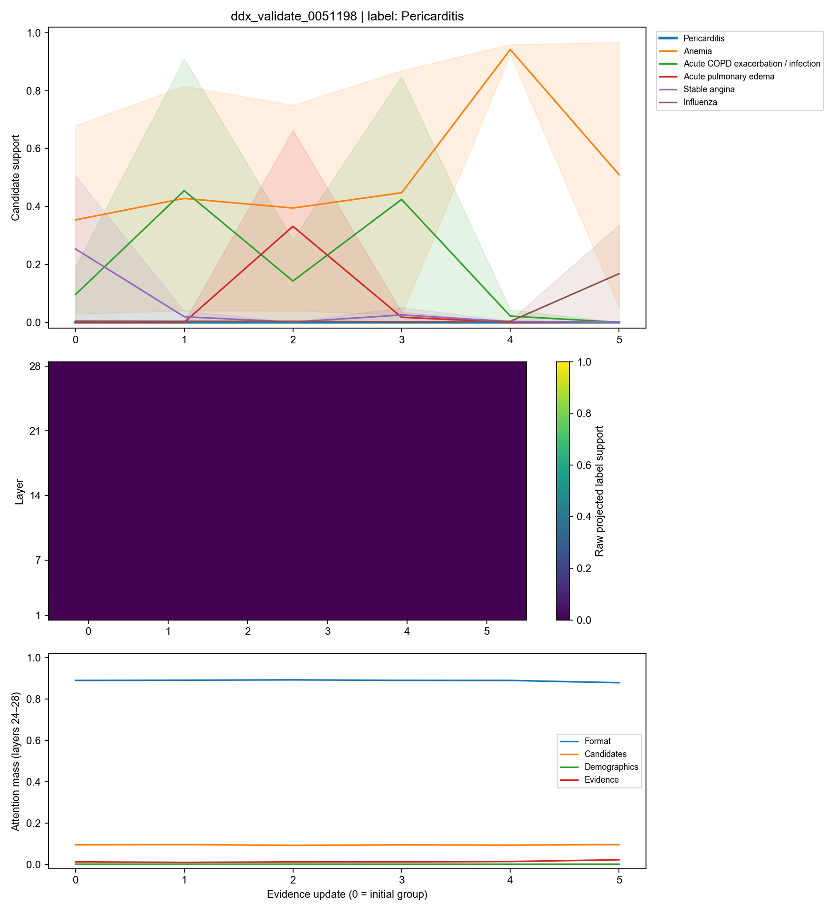

# ddx_validate_0051198

源标签：**Pericarditis**；参考首位：**Pericarditis**。

实线为两个编码的平均分，阴影为两编码范围；逐层热图为原始投影，注意力曲线为晚5层均值。终点评价使用三个编码，可能与此处两编码轨迹不同。

| 轮 | 新证据（原始英文） | 当前首选 | 标签支持 |
|---|---|---|---|
| 0 | Do you have pain that is increased when you breathe in deeply? **Yes** | Anemia | 0.0000 |
| 1 | Are your symptoms worse when lying down and alleviated while sitting up? **Yes** | Acute COPD exacerbation / infection | 0.0000 |
| 2 | Are you experiencing shortness of breath or difficulty breathing in a significant way? **Yes** | Anemia | 0.0000 |
| 3 | Have you traveled out of the country in the last 4 weeks? **No** | Anemia | 0.0000 |
| 4 | Have you recently had a viral infection? **Yes** | Anemia | 0.0000 |
| 5 | Do you have pain somewhere, related to your reason for consulting? **Yes** Characterize your pain: **sharp** Do you feel pain somewhere? **lower chest; upper chest; breast(R); epigastric** How intense is the pain? **Recorded scale value 8 on the dataset's 0-10 scale; endpoint meanings are unspecified** Does the pain radiate to another location? **posterior chest wall(R); posterior chest wall(L)** How precisely is the pain located? **Recorded scale value 6 on the dataset's 0-10 scale; endpoint meanings are unspecified** How fast did the pain appear? **Recorded scale value 7 on the dataset's 0-10 scale; endpoint meanings are unspecified** | Anemia | 0.0001 |
