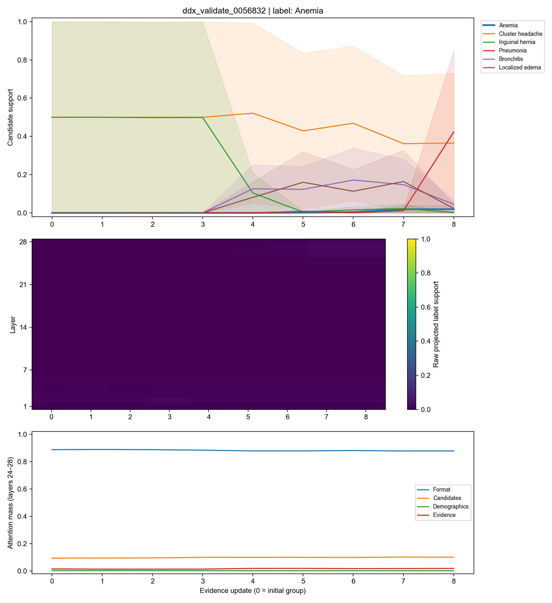

# ddx_validate_0056832

源标签：**Anemia**；参考首位：**Anemia**。

实线为两个编码的平均分，阴影为两编码范围；逐层热图为原始投影，注意力曲线为晚5层均值。终点评价使用三个编码，可能与此处两编码轨迹不同。

| 轮 | 新证据（原始英文） | 当前首选 | 标签支持 |
|---|---|---|---|
| 0 | Do you feel slightly dizzy or lightheaded? **Yes** | Inguinal hernia | 0.0000 |
| 1 | Is your BMI less than 18.5, or are you underweight? **Yes** | Cluster headache | 0.0000 |
| 2 | Do you constantly feel fatigued or do you have non-restful sleep? **Yes** | Cluster headache | 0.0000 |
| 3 | Have you traveled out of the country in the last 4 weeks? **Asia** | Cluster headache | 0.0000 |
| 4 | Do you have pain somewhere, related to your reason for consulting? **Yes** Characterize your pain: **tugging; a cramp; exhausting** Do you feel pain somewhere? **back of head; forehead; temple(R); temple(L)** How intense is the pain? **Recorded scale value 1 on the dataset's 0-10 scale; endpoint meanings are unspecified** Does the pain radiate to another location? **nowhere** How precisely is the pain located? **Recorded scale value 3 on the dataset's 0-10 scale; endpoint meanings are unspecified** How fast did the pain appear? **Recorded scale value 4 on the dataset's 0-10 scale; endpoint meanings are unspecified** | Cluster headache | 0.0000 |
| 5 | Have you noticed light red blood or blood clots in your stool? **Yes** | Cluster headache | 0.0012 |
| 6 | Is your skin much paler than usual? **Yes** | Cluster headache | 0.0040 |
| 7 | Do you have very abundant or very long menstruation periods? **Yes** | Cluster headache | 0.0190 |
| 8 | Are you experiencing shortness of breath or difficulty breathing in a significant way? **Yes** | Pneumonia | 0.0193 |
