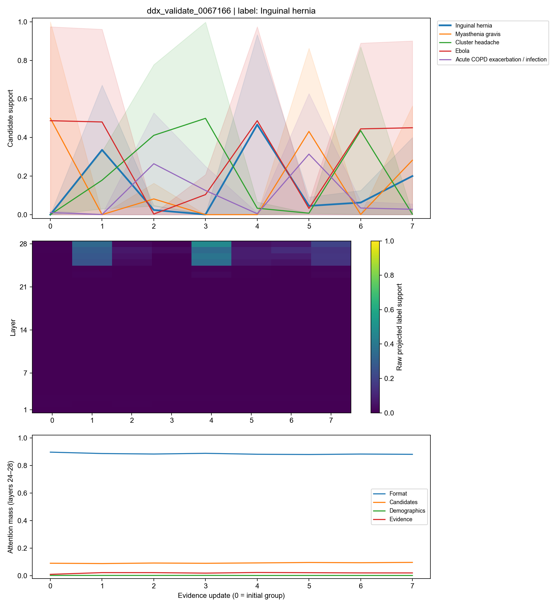

# ddx_validate_0067166

源标签：**Inguinal hernia**；参考首位：**Inguinal hernia**。

实线为两个编码的平均分，阴影为两编码范围；逐层热图为原始投影，注意力曲线为晚5层均值。终点评价使用三个编码，可能与此处两编码轨迹不同。

| 轮 | 新证据（原始英文） | 当前首选 | 标签支持 |
|---|---|---|---|
| 0 | Have you been able to pass stools or gas since your symptoms increased? **Yes** | Myasthenia gravis | 0.0000 |
| 1 | Do you have pain somewhere, related to your reason for consulting? **Yes** Characterize your pain: **heavy** Do you feel pain somewhere? **iliac fossa(L); hip(R); hip(L)** How intense is the pain? **Recorded scale value 2 on the dataset's 0-10 scale; endpoint meanings are unspecified** Does the pain radiate to another location? **nowhere** How precisely is the pain located? **Recorded scale value 4 on the dataset's 0-10 scale; endpoint meanings are unspecified** How fast did the pain appear? **Recorded scale value 1 on the dataset's 0-10 scale; endpoint meanings are unspecified** | Ebola | 0.3359 |
| 2 | Do you have intense coughing fits? **Yes** | Cluster headache | 0.0241 |
| 3 | Were you born prematurely or did you suffer any complication at birth? **Yes** | Cluster headache | 0.0009 |
| 4 | Do you have any lesions, redness or problems on your skin that you believe are related to the condition you are consulting for? **Yes** What color is the rash? **pale** Do your lesions peel off? **No** Is the rash swollen? **Recorded scale value 2 on the dataset's 0-10 scale; endpoint meanings are unspecified** Where is the affected region located? **iliac fossa(L)** How intense is the pain caused by the rash? **Recorded scale value 2 on the dataset's 0-10 scale; endpoint meanings are unspecified** Is the lesion (or are the lesions) larger than 1cm? **Yes** How severe is the itching? **Recorded scale value 0 on the dataset's 0-10 scale; endpoint meanings are unspecified** | Ebola | 0.4667 |
| 5 | Are the symptoms or pain increased with coughing, with an effort like lifting a weight or from forcing a bowel movement? **Yes** | Myasthenia gravis | 0.0455 |
| 6 | Have you traveled out of the country in the last 4 weeks? **No** | Ebola | 0.0627 |
| 7 | Are you significantly overweight compared to people of the same height as you? **Yes** | Ebola | 0.2000 |
