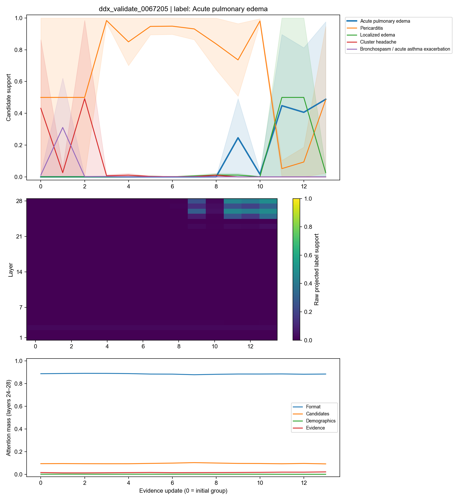

# ddx_validate_0067205

源标签：**Acute pulmonary edema**；参考首位：**Acute pulmonary edema**。

实线为两个编码的平均分，阴影为两编码范围；逐层热图为原始投影，注意力曲线为晚5层均值。终点评价使用三个编码，可能与此处两编码轨迹不同。

| 轮 | 新证据（原始英文） | 当前首选 | 标签支持 |
|---|---|---|---|
| 0 | Are your symptoms worse when lying down and alleviated while sitting up? **Yes** | Pericarditis | 0.0000 |
| 1 | Do you have symptoms that are increased with physical exertion but alleviated with rest? **Yes** | Pericarditis | 0.0000 |
| 2 | Have you had significantly increased sweating? **Yes** | Pericarditis | 0.0000 |
| 3 | Have you ever had a heart attack or do you have angina (chest pain)? **Yes** | Pericarditis | 0.0000 |
| 4 | Have you noticed any new fatigue, generalized and vague discomfort, diffuse (widespread) muscle aches or a change in your general well-being related to your consultation today? **Yes** | Pericarditis | 0.0000 |
| 5 | Do you currently undergo dialysis? **Yes** | Pericarditis | 0.0000 |
| 6 | Do you have high blood pressure or do you take medications to treat high blood pressure? **Yes** | Pericarditis | 0.0000 |
| 7 | Have you ever had fluid in your lungs? **Yes** | Pericarditis | 0.0000 |
| 8 | Do you have bouts of choking or shortness of breath that wake you up at night? **Yes** | Pericarditis | 0.0004 |
| 9 | Do you have heart failure? **Yes** | Pericarditis | 0.2461 |
| 10 | Have you traveled out of the country in the last 4 weeks? **North America** | Pericarditis | 0.0165 |
| 11 | Do you have swelling in one or more areas of your body? **Yes** Where is the swelling located? **ankle(R); ankle(L); calf(L); tibia(R); tibia(L)** | Localized edema | 0.4480 |
| 12 | Are you experiencing shortness of breath or difficulty breathing in a significant way? **Yes** | Localized edema | 0.4063 |
| 13 | Do you have pain somewhere, related to your reason for consulting? **Yes** Characterize your pain: **tedious; sensitive; tugging; heavy** Do you feel pain somewhere? **lower chest; ankle(L); side of the chest(R); breast(R); posterior chest wall(L)** How intense is the pain? **Recorded scale value 5 on the dataset's 0-10 scale; endpoint meanings are unspecified** Does the pain radiate to another location? **chin; triceps(R)** How precisely is the pain located? **Recorded scale value 2 on the dataset's 0-10 scale; endpoint meanings are unspecified** How fast did the pain appear? **Recorded scale value 6 on the dataset's 0-10 scale; endpoint meanings are unspecified** | Acute pulmonary edema | 0.4881 |
