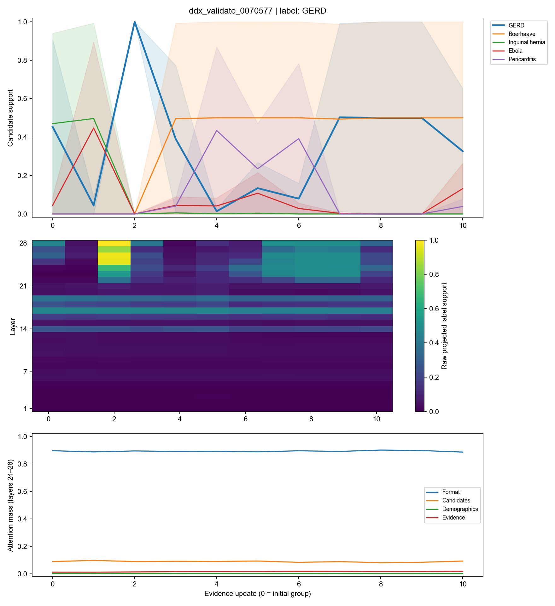

# ddx_validate_0070577

源标签：**GERD**；参考首位：**GERD**。

实线为两个编码的平均分，阴影为两编码范围；逐层热图为原始投影，注意力曲线为晚5层均值。终点评价使用三个编码，可能与此处两编码轨迹不同。

| 轮 | 新证据（原始英文） | 当前首选 | 标签支持 |
|---|---|---|---|
| 0 | Are your symptoms worse when lying down and alleviated while sitting up? **Yes** | Inguinal hernia | 0.4534 |
| 1 | Do you drink alcohol excessively or do you have an addiction to alcohol? **Yes** | Inguinal hernia | 0.0443 |
| 2 | Do you have a burning sensation that starts in your stomach then goes up into your throat, and can be associated with a bitter taste in your mouth? **Yes** | GERD | 0.9995 |
| 3 | Have you recently thrown up blood or something resembling coffee beans? **Yes** | Boerhaave | 0.3907 |
| 4 | Do you have asthma or have you ever had to use a bronchodilator in the past? **Yes** | Boerhaave | 0.0140 |
| 5 | Do you have a cough? **Yes** | Boerhaave | 0.1341 |
| 6 | Do you have pain somewhere, related to your reason for consulting? **Yes** Characterize your pain: **haunting; sensitive; tugging; burning; sickening** Do you feel pain somewhere? **hypochondrium(L); belly; epigastric** How intense is the pain? **Recorded scale value 5 on the dataset's 0-10 scale; endpoint meanings are unspecified** Does the pain radiate to another location? **upper chest** How precisely is the pain located? **Recorded scale value 8 on the dataset's 0-10 scale; endpoint meanings are unspecified** How fast did the pain appear? **Recorded scale value 1 on the dataset's 0-10 scale; endpoint meanings are unspecified** | Boerhaave | 0.0796 |
| 7 | Do you smoke cigarettes? **Yes** | GERD | 0.5026 |
| 8 | Do you have symptoms that get worse after eating? **Yes** | Boerhaave | 0.5000 |
| 9 | Have you traveled out of the country in the last 4 weeks? **No** | Boerhaave | 0.5000 |
| 10 | Are you significantly overweight compared to people of the same height as you? **Yes** | Boerhaave | 0.3262 |
