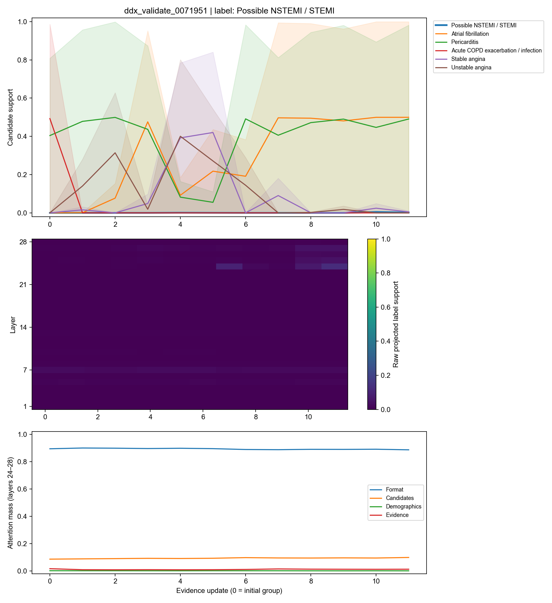

# ddx_validate_0071951

源标签：**Possible NSTEMI / STEMI**；参考首位：**Possible NSTEMI / STEMI**。

实线为两个编码的平均分，阴影为两编码范围；逐层热图为原始投影，注意力曲线为晚5层均值。终点评价使用三个编码，可能与此处两编码轨迹不同。

| 轮 | 新证据（原始英文） | 当前首选 | 标签支持 |
|---|---|---|---|
| 0 | Are you experiencing shortness of breath or difficulty breathing in a significant way? **Yes** | Acute COPD exacerbation / infection | 0.0000 |
| 1 | Have you ever had a heart attack or do you have angina (chest pain)? **Yes** | Pericarditis | 0.0000 |
| 2 | Have you had significantly increased sweating? **Yes** | Pericarditis | 0.0000 |
| 3 | Are you significantly overweight compared to people of the same height as you? **Yes** | Atrial fibrillation | 0.0001 |
| 4 | Do you have a problem with poor circulation? **Yes** | Unstable angina | 0.0008 |
| 5 | Have you traveled out of the country in the last 4 weeks? **No** | Stable angina | 0.0003 |
| 6 | Do you have diabetes? **Yes** | Pericarditis | 0.0001 |
| 7 | Do you have pain somewhere, related to your reason for consulting? **Yes** Characterize your pain: **tedious; heavy; sharp; sickening; scary** Do you feel pain somewhere? **lower chest; biceps(R); side of the chest(R); breast(L); shoulder(R)** How intense is the pain? **Recorded scale value 7 on the dataset's 0-10 scale; endpoint meanings are unspecified** Does the pain radiate to another location? **biceps(R); biceps(L); thyroid cartilage; thoracic spine; shoulder(L)** How precisely is the pain located? **Recorded scale value 8 on the dataset's 0-10 scale; endpoint meanings are unspecified** How fast did the pain appear? **Recorded scale value 7 on the dataset's 0-10 scale; endpoint meanings are unspecified** | Atrial fibrillation | 0.0000 |
| 8 | Do you have high cholesterol or do you take medications to treat high cholesterol? **Yes** | Atrial fibrillation | 0.0000 |
| 9 | Do you have high blood pressure or do you take medications to treat high blood pressure? **Yes** | Pericarditis | 0.0000 |
| 10 | Do you have close family members who had a cardiovascular disease problem before the age of 50? **Yes** | Atrial fibrillation | 0.0045 |
| 11 | Have you recently had a loss of appetite or do you get full more quickly then usually? **Yes** | Atrial fibrillation | 0.0019 |
