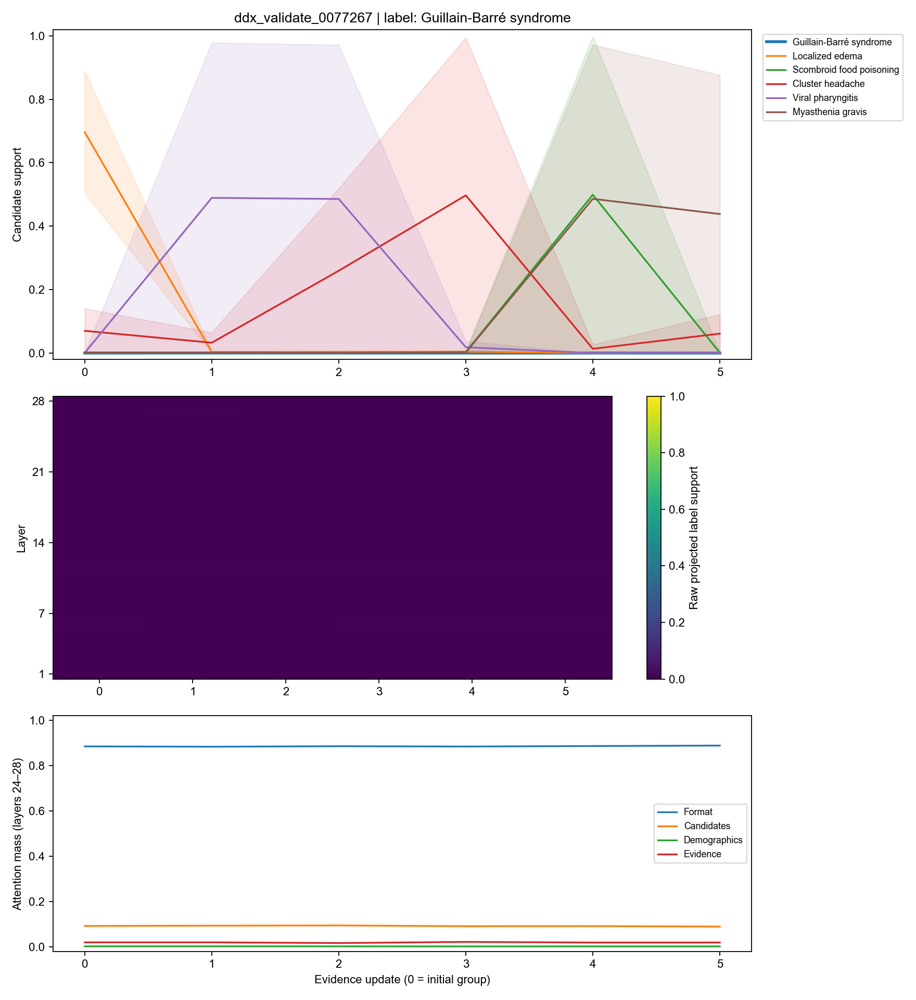

# ddx_validate_0077267

源标签：**Guillain-Barré syndrome**；参考首位：**Guillain-Barré syndrome**。

实线为两个编码的平均分，阴影为两编码范围；逐层热图为原始投影，注意力曲线为晚5层均值。终点评价使用三个编码，可能与此处两编码轨迹不同。

| 轮 | 新证据（原始英文） | 当前首选 | 标签支持 |
|---|---|---|---|
| 0 | Have you noticed weakness in your facial muscles and/or eyes? **Yes** | Localized edema | 0.0000 |
| 1 | Have you recently had a viral infection? **Yes** | Viral pharyngitis | 0.0001 |
| 2 | Have you traveled out of the country in the last 4 weeks? **No** | Viral pharyngitis | 0.0001 |
| 3 | Have you had weakness or paralysis on one side of the face, which may still be present or completely resolved? **Yes** | Cluster headache | 0.0000 |
| 4 | Have you recently had numbness, loss of sensation or tingling, in both arms and legs and around your mouth? **Yes** | Scombroid food poisoning | 0.0000 |
| 5 | Do you feel weakness in both arms and/or both legs? **Yes** | URTI | 0.0000 |
