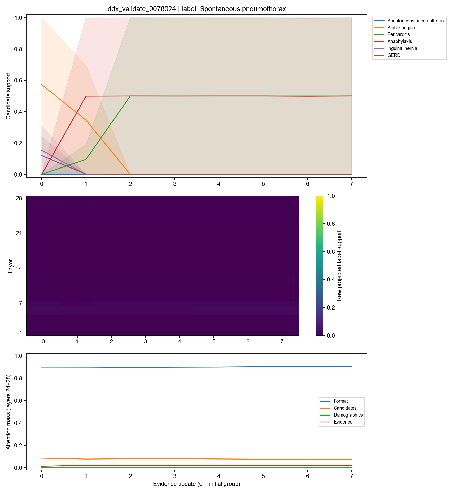

# ddx_validate_0078024

源标签：**Spontaneous pneumothorax**；参考首位：**Unstable angina**。

实线为两个编码的平均分，阴影为两编码范围；逐层热图为原始投影，注意力曲线为晚5层均值。终点评价使用三个编码，可能与此处两编码轨迹不同。

| 轮 | 新证据（原始英文） | 当前首选 | 标签支持 |
|---|---|---|---|
| 0 | Do you have symptoms that are increased with physical exertion but alleviated with rest? **Yes** | Stable angina | 0.0004 |
| 1 | Do you have pain somewhere, related to your reason for consulting? **Yes** Characterize your pain: **heartbreaking; violent** Do you feel pain somewhere? **side of the chest(R); upper chest; breast(R)** How intense is the pain? **Recorded scale value 8 on the dataset's 0-10 scale; endpoint meanings are unspecified** Does the pain radiate to another location? **nowhere** How precisely is the pain located? **Recorded scale value 1 on the dataset's 0-10 scale; endpoint meanings are unspecified** How fast did the pain appear? **Recorded scale value 5 on the dataset's 0-10 scale; endpoint meanings are unspecified** | Anaphylaxis | 0.0000 |
| 2 | Do you have pain that is increased when you breathe in deeply? **Yes** | Pericarditis | 0.0000 |
| 3 | Are you experiencing shortness of breath or difficulty breathing in a significant way? **Yes** | Pericarditis | 0.0000 |
| 4 | Do you have chest pain even at rest? **Yes** | Anaphylaxis | 0.0000 |
| 5 | Have you ever had a spontaneous pneumothorax? **Yes** | Anaphylaxis | 0.0000 |
| 6 | Have you traveled out of the country in the last 4 weeks? **No** | Pericarditis | 0.0000 |
| 7 | Have any of your family members ever had a pneumothorax? **Yes** | Pericarditis | 0.0000 |
