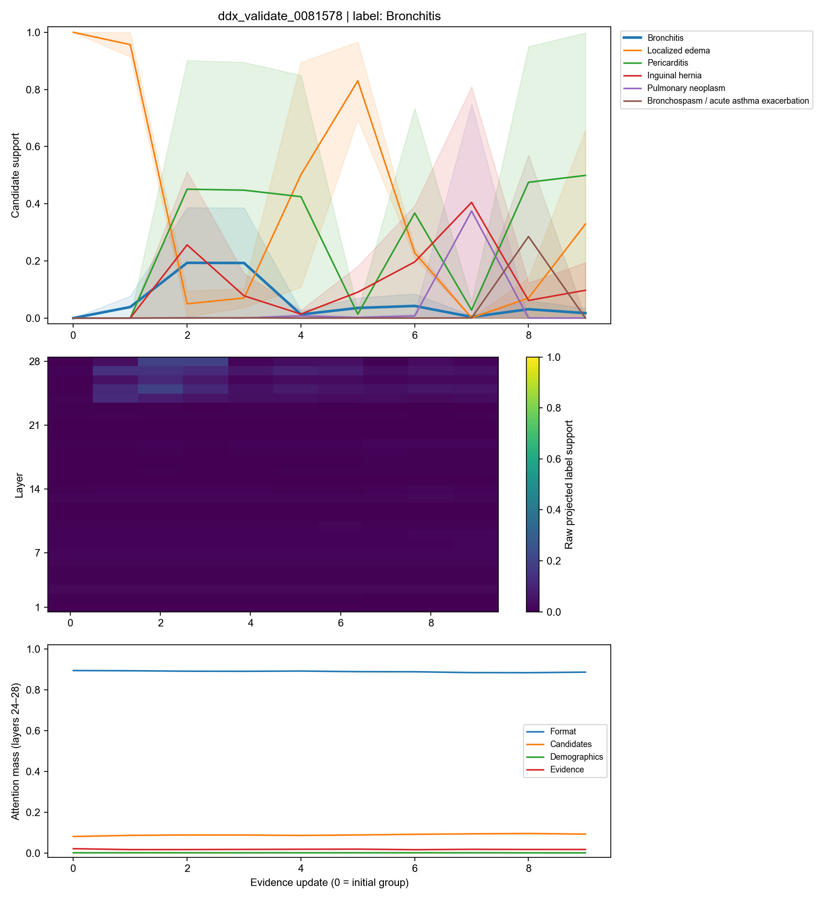

# ddx_validate_0081578

源标签：**Bronchitis**；参考首位：**Pneumonia**。

实线为两个编码的平均分，阴影为两编码范围；逐层热图为原始投影，注意力曲线为晚5层均值。终点评价使用三个编码，可能与此处两编码轨迹不同。

| 轮 | 新证据（原始英文） | 当前首选 | 标签支持 |
|---|---|---|---|
| 0 | Are you experiencing shortness of breath or difficulty breathing in a significant way? **Yes** | Localized edema | 0.0000 |
| 1 | Have you noticed a wheezing sound when you exhale? **Yes** | Localized edema | 0.0387 |
| 2 | Do you have a sore throat? **Yes** | Pericarditis | 0.1934 |
| 3 | Do you have a cough? **Yes** | Pericarditis | 0.1928 |
| 4 | Have you traveled out of the country in the last 4 weeks? **No** | Localized edema | 0.0127 |
| 5 | Do you have a fever (either felt or measured with a thermometer)? **Yes** | Localized edema | 0.0355 |
| 6 | Do you smoke cigarettes? **Yes** | Pericarditis | 0.0425 |
| 7 | Do you have pain somewhere, related to your reason for consulting? **Yes** Characterize your pain: **sensitive** Do you feel pain somewhere? **breast(L); posterior chest wall(R)** How intense is the pain? **Recorded scale value 2 on the dataset's 0-10 scale; endpoint meanings are unspecified** Does the pain radiate to another location? **nowhere** How precisely is the pain located? **Recorded scale value 3 on the dataset's 0-10 scale; endpoint meanings are unspecified** How fast did the pain appear? **Recorded scale value 1 on the dataset's 0-10 scale; endpoint meanings are unspecified** | Inguinal hernia | 0.0041 |
| 8 | Do you have a cough that produces colored or more abundant sputum than usual? **Yes** | Pericarditis | 0.0310 |
| 9 | Are your symptoms more prominent at night? **Yes** | Pericarditis | 0.0174 |
