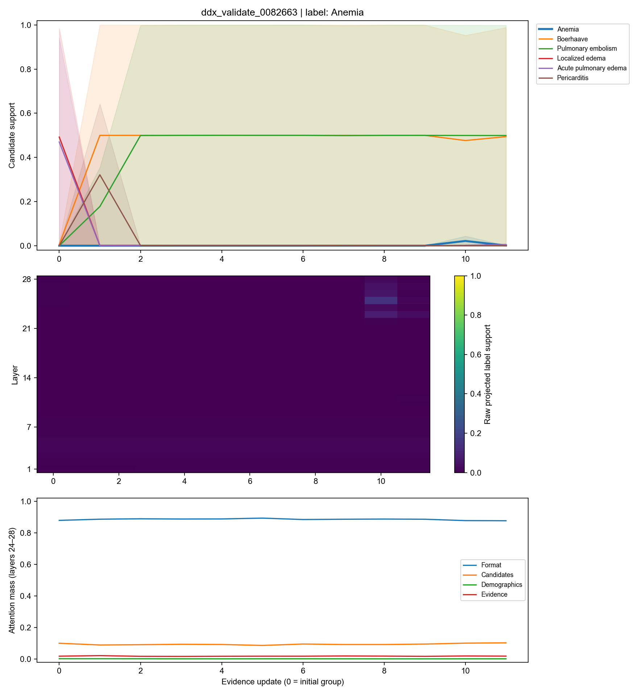

# ddx_validate_0082663

源标签：**Anemia**；参考首位：**Anemia**。

实线为两个编码的平均分，阴影为两编码范围；逐层热图为原始投影，注意力曲线为晚5层均值。终点评价使用三个编码，可能与此处两编码轨迹不同。

| 轮 | 新证据（原始英文） | 当前首选 | 标签支持 |
|---|---|---|---|
| 0 | Do you feel lightheaded and dizzy or do you feel like you are about to faint? **Yes** | Localized edema | 0.0002 |
| 1 | Have you noticed light red blood or blood clots in your stool? **Yes** | Boerhaave | 0.0000 |
| 2 | Are you taking any new oral anticoagulants ((NOACs)? **Yes** | Boerhaave | 0.0000 |
| 3 | Do you have pain somewhere, related to your reason for consulting? **Yes** Characterize your pain: **exhausting** Do you feel pain somewhere? **top of the head; forehead** How intense is the pain? **Recorded scale value 2 on the dataset's 0-10 scale; endpoint meanings are unspecified** Does the pain radiate to another location? **nowhere** How precisely is the pain located? **Recorded scale value 2 on the dataset's 0-10 scale; endpoint meanings are unspecified** How fast did the pain appear? **Recorded scale value 2 on the dataset's 0-10 scale; endpoint meanings are unspecified** | Boerhaave | 0.0000 |
| 4 | Is your skin much paler than usual? **Yes** | Boerhaave | 0.0000 |
| 5 | Is your BMI less than 18.5, or are you underweight? **Yes** | Pulmonary embolism | 0.0000 |
| 6 | Do you think you are pregnant or are you currently pregnant? **Yes** | Pulmonary embolism | 0.0000 |
| 7 | Have you traveled out of the country in the last 4 weeks? **No** | Boerhaave | 0.0000 |
| 8 | Do you constantly feel fatigued or do you have non-restful sleep? **Yes** | Boerhaave | 0.0000 |
| 9 | Do you have chronic kidney failure? **Yes** | Boerhaave | 0.0000 |
| 10 | Have you ever had a diagnosis of anemia? **Yes** | Pulmonary embolism | 0.0216 |
| 11 | Do you feel slightly dizzy or lightheaded? **Yes** | Pulmonary embolism | 0.0009 |
