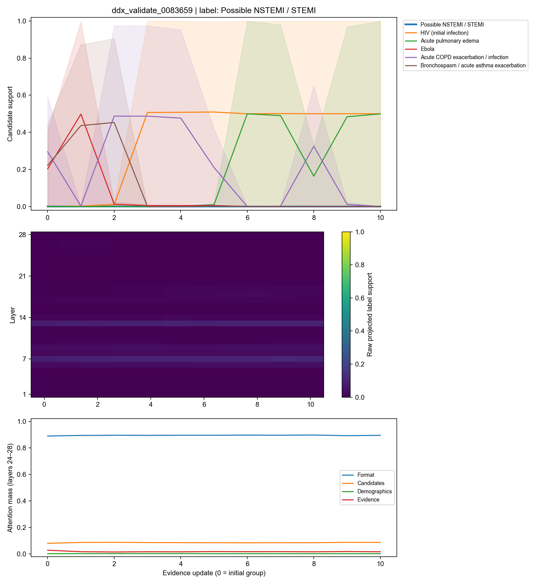

# ddx_validate_0083659

源标签：**Possible NSTEMI / STEMI**；参考首位：**Possible NSTEMI / STEMI**。

实线为两个编码的平均分，阴影为两编码范围；逐层热图为原始投影，注意力曲线为晚5层均值。终点评价使用三个编码，可能与此处两编码轨迹不同。

| 轮 | 新证据（原始英文） | 当前首选 | 标签支持 |
|---|---|---|---|
| 0 | Are you experiencing shortness of breath or difficulty breathing in a significant way? **Yes** | Acute COPD exacerbation / infection | 0.0000 |
| 1 | Have you recently had a loss of appetite or do you get full more quickly then usually? **Yes** | Ebola | 0.0003 |
| 2 | Do you have high cholesterol or do you take medications to treat high cholesterol? **Yes** | Acute COPD exacerbation / infection | 0.0003 |
| 3 | Are you infected with the human immunodeficiency virus (HIV)? **Yes** | HIV (initial infection) | 0.0000 |
| 4 | Do you constantly feel fatigued or do you have non-restful sleep? **Yes** | HIV (initial infection) | 0.0000 |
| 5 | Do you have pain somewhere, related to your reason for consulting? **Yes** Characterize your pain: **tedious; heavy; sharp; sickening** Do you feel pain somewhere? **biceps(L); side of the chest(L); upper chest; breast(L); epigastric** How intense is the pain? **Recorded scale value 9 on the dataset's 0-10 scale; endpoint meanings are unspecified** Does the pain radiate to another location? **biceps(R); trachea; triceps(L); shoulder(R); shoulder(L)** How precisely is the pain located? **Recorded scale value 7 on the dataset's 0-10 scale; endpoint meanings are unspecified** How fast did the pain appear? **Recorded scale value 10 on the dataset's 0-10 scale; endpoint meanings are unspecified** | HIV (initial infection) | 0.0000 |
| 6 | Have you had significantly increased sweating? **Yes** | HIV (initial infection) | 0.0000 |
| 7 | Have you traveled out of the country in the last 4 weeks? **No** | HIV (initial infection) | 0.0000 |
| 8 | Do you have close family members who had a cardiovascular disease problem before the age of 50? **Yes** | HIV (initial infection) | 0.0000 |
| 9 | Are you significantly overweight compared to people of the same height as you? **Yes** | HIV (initial infection) | 0.0000 |
| 10 | Do you have high blood pressure or do you take medications to treat high blood pressure? **Yes** | HIV (initial infection) | 0.0000 |
