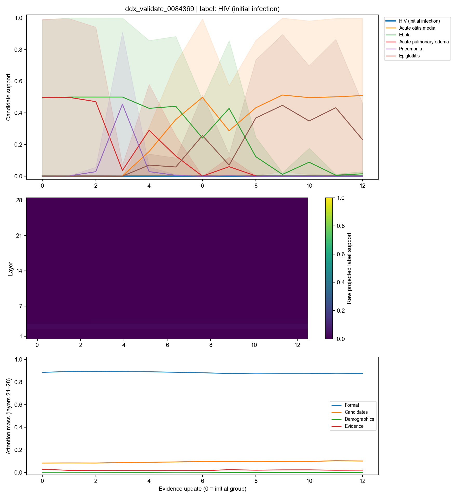

# ddx_validate_0084369

源标签：**HIV (initial infection)**；参考首位：**HIV (initial infection)**。

实线为两个编码的平均分，阴影为两编码范围；逐层热图为原始投影，注意力曲线为晚5层均值。终点评价使用三个编码，可能与此处两编码轨迹不同。

| 轮 | 新证据（原始英文） | 当前首选 | 标签支持 |
|---|---|---|---|
| 0 | Are you feeling nauseous or do you feel like vomiting? **Yes** | Acute pulmonary edema | 0.0000 |
| 1 | Do you have a fever (either felt or measured with a thermometer)? **Yes** | Ebola | 0.0000 |
| 2 | Have you had an involuntary weight loss over the last 3 months? **Yes** | Ebola | 0.0000 |
| 3 | Have you had unprotected sex with more than one partner in the last 6 months? **Yes** | Ebola | 0.0000 |
| 4 | Have you had significantly increased sweating? **Yes** | Ebola | 0.0000 |
| 5 | Have you ever had a sexually transmitted infection? **Yes** | Ebola | 0.0000 |
| 6 | Have you had sexual intercourse with an HIV-positive partner in the past 12 months? **Yes** | Acute otitis media | 0.0000 |
| 7 | Do you have any lesions, redness or problems on your skin that you believe are related to the condition you are consulting for? **Yes** What color is the rash? **pale** Do your lesions peel off? **No** Is the rash swollen? **Recorded scale value 1 on the dataset's 0-10 scale; endpoint meanings are unspecified** Where is the affected region located? **lower gum; upper gum; internal cheek(R); internal cheek(L); bottom lip(R)** How intense is the pain caused by the rash? **Recorded scale value 3 on the dataset's 0-10 scale; endpoint meanings are unspecified** Is the lesion (or are the lesions) larger than 1cm? **Yes** How severe is the itching? **Recorded scale value 0 on the dataset's 0-10 scale; endpoint meanings are unspecified** | Ebola | 0.0000 |
| 8 | Have you traveled out of the country in the last 4 weeks? **No** | Acute otitis media | 0.0001 |
| 9 | Are you currently using intravenous drugs? **Yes** | Acute otitis media | 0.0000 |
| 10 | Do you feel so tired that you are unable to do your usual activities or are you stuck in your bed all day long? **Yes** | Acute otitis media | 0.0000 |
| 11 | Do you have swollen or painful lymph nodes? **Yes** | Acute otitis media | 0.0000 |
| 12 | Do you have pain somewhere, related to your reason for consulting? **Yes** Characterize your pain: **tedious; a pulse** Do you feel pain somewhere? **back of head; back of the neck; temple(L)** How intense is the pain? **Recorded scale value 8 on the dataset's 0-10 scale; endpoint meanings are unspecified** Does the pain radiate to another location? **nowhere** How precisely is the pain located? **Recorded scale value 2 on the dataset's 0-10 scale; endpoint meanings are unspecified** How fast did the pain appear? **Recorded scale value 1 on the dataset's 0-10 scale; endpoint meanings are unspecified** | Acute otitis media | 0.0002 |
