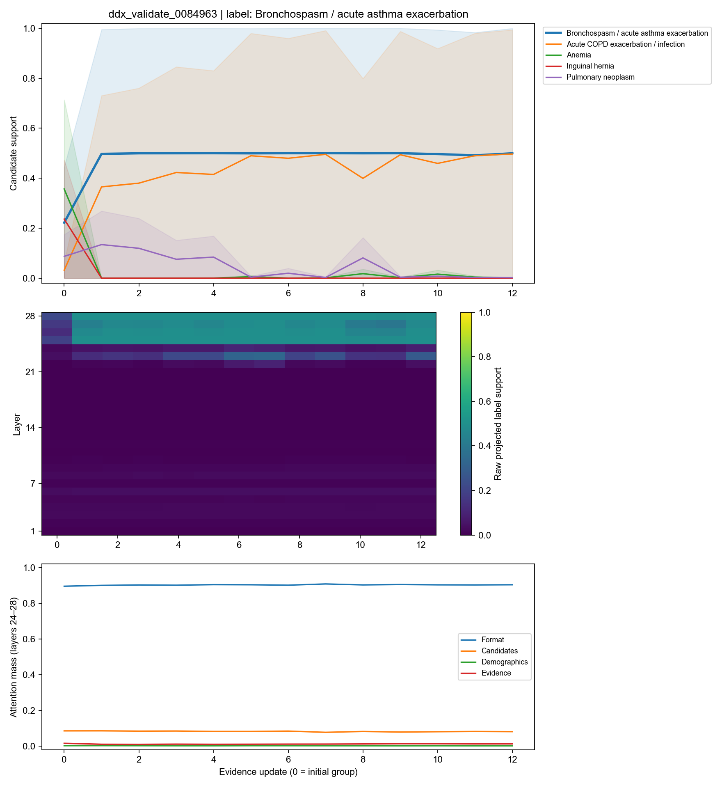

# ddx_validate_0084963

源标签：**Bronchospasm / acute asthma exacerbation**；参考首位：**Bronchospasm / acute asthma exacerbation**。

实线为两个编码的平均分，阴影为两编码范围；逐层热图为原始投影，注意力曲线为晚5层均值。终点评价使用三个编码，可能与此处两编码轨迹不同。

| 轮 | 新证据（原始英文） | 当前首选 | 标签支持 |
|---|---|---|---|
| 0 | Have you noticed a wheezing sound when you exhale? **Yes** | Anemia | 0.2222 |
| 1 | Have you been hospitalized for an asthma attack in the past year? **Yes** | Bronchospasm / acute asthma exacerbation | 0.4975 |
| 2 | Are you exposed to secondhand cigarette smoke on a daily basis? **Yes** | Bronchospasm / acute asthma exacerbation | 0.4997 |
| 3 | Do you live in in a big city? **Yes** | Bronchospasm / acute asthma exacerbation | 0.4998 |
| 4 | Are you more likely to develop common allergies than the general population? **Yes** | Bronchospasm / acute asthma exacerbation | 0.5000 |
| 5 | Do you have a cough? **Yes** | Bronchospasm / acute asthma exacerbation | 0.4996 |
| 6 | Have you had 2 or more asthma attacks in the past year? **Yes** | Bronchospasm / acute asthma exacerbation | 0.5000 |
| 7 | Are you experiencing shortness of breath or difficulty breathing in a significant way? **Yes** | Bronchospasm / acute asthma exacerbation | 0.5000 |
| 8 | Have you traveled out of the country in the last 4 weeks? **No** | Bronchospasm / acute asthma exacerbation | 0.4997 |
| 9 | Have you had a cold in the last 2 weeks? **Yes** | Bronchospasm / acute asthma exacerbation | 0.5000 |
| 10 | Have you been diagnosed with chronic sinusitis? **Yes** | Bronchospasm / acute asthma exacerbation | 0.4967 |
| 11 | Do you have any family members who have asthma? **Yes** | Bronchospasm / acute asthma exacerbation | 0.4916 |
| 12 | Do you have asthma or have you ever had to use a bronchodilator in the past? **Yes** | Bronchospasm / acute asthma exacerbation | 0.4998 |
