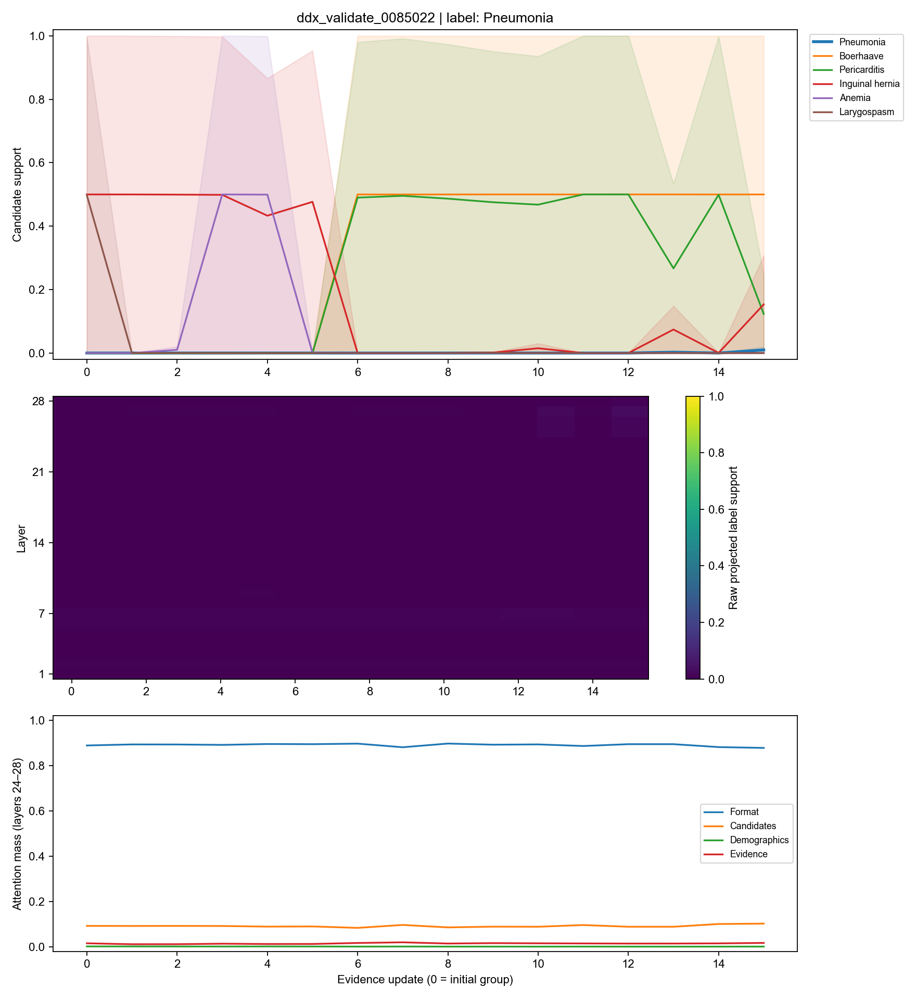

# ddx_validate_0085022

源标签：**Pneumonia**；参考首位：**Pneumonia**。

实线为两个编码的平均分，阴影为两编码范围；逐层热图为原始投影，注意力曲线为晚5层均值。终点评价使用三个编码，可能与此处两编码轨迹不同。

| 轮 | 新证据（原始英文） | 当前首选 | 标签支持 |
|---|---|---|---|
| 0 | Have you been coughing up blood? **Yes** | Inguinal hernia | 0.0000 |
| 1 | Do you have diffuse (widespread) muscle pain? **Yes** | Inguinal hernia | 0.0000 |
| 2 | Do you have a cough that produces colored or more abundant sputum than usual? **Yes** | Inguinal hernia | 0.0000 |
| 3 | Is your BMI less than 18.5, or are you underweight? **Yes** | Anemia | 0.0000 |
| 4 | Do you have asthma or have you ever had to use a bronchodilator in the past? **Yes** | Anemia | 0.0001 |
| 5 | Have you traveled out of the country in the last 4 weeks? **No** | Inguinal hernia | 0.0001 |
| 6 | Do you have pain somewhere, related to your reason for consulting? **Yes** Characterize your pain: **a knife stroke** Do you feel pain somewhere? **side of the chest(R); posterior chest wall(R); posterior chest wall(L)** How intense is the pain? **Recorded scale value 4 on the dataset's 0-10 scale; endpoint meanings are unspecified** Does the pain radiate to another location? **nowhere** How precisely is the pain located? **Recorded scale value 2 on the dataset's 0-10 scale; endpoint meanings are unspecified** How fast did the pain appear? **Recorded scale value 2 on the dataset's 0-10 scale; endpoint meanings are unspecified** | Boerhaave | 0.0000 |
| 7 | Do you have nasal congestion or a clear runny nose? **Yes** | Boerhaave | 0.0000 |
| 8 | Have you ever had pneumonia? **Yes** | Boerhaave | 0.0000 |
| 9 | Do you smoke cigarettes? **Yes** | Boerhaave | 0.0001 |
| 10 | Do you have pain that is increased when you breathe in deeply? **Yes** | Boerhaave | 0.0001 |
| 11 | Do you have a chronic obstructive pulmonary disease (COPD)? **Yes** | Pericarditis | 0.0000 |
| 12 | Have you ever had a stroke? **Yes** | Boerhaave | 0.0000 |
| 13 | Have you had chills or shivers? **Yes** | Boerhaave | 0.0027 |
| 14 | Have you recently had a loss of appetite or do you get full more quickly then usually? **Yes** | Boerhaave | 0.0000 |
| 15 | What color is the rash? **NA** Do your lesions peel off? **No** Is the rash swollen? **Recorded scale value 0 on the dataset's 0-10 scale; endpoint meanings are unspecified** Where is the affected region located? **nowhere** How intense is the pain caused by the rash? **Recorded scale value 0 on the dataset's 0-10 scale; endpoint meanings are unspecified** Is the lesion (or are the lesions) larger than 1cm? **No** How severe is the itching? **Recorded scale value 0 on the dataset's 0-10 scale; endpoint meanings are unspecified** | Boerhaave | 0.0098 |
