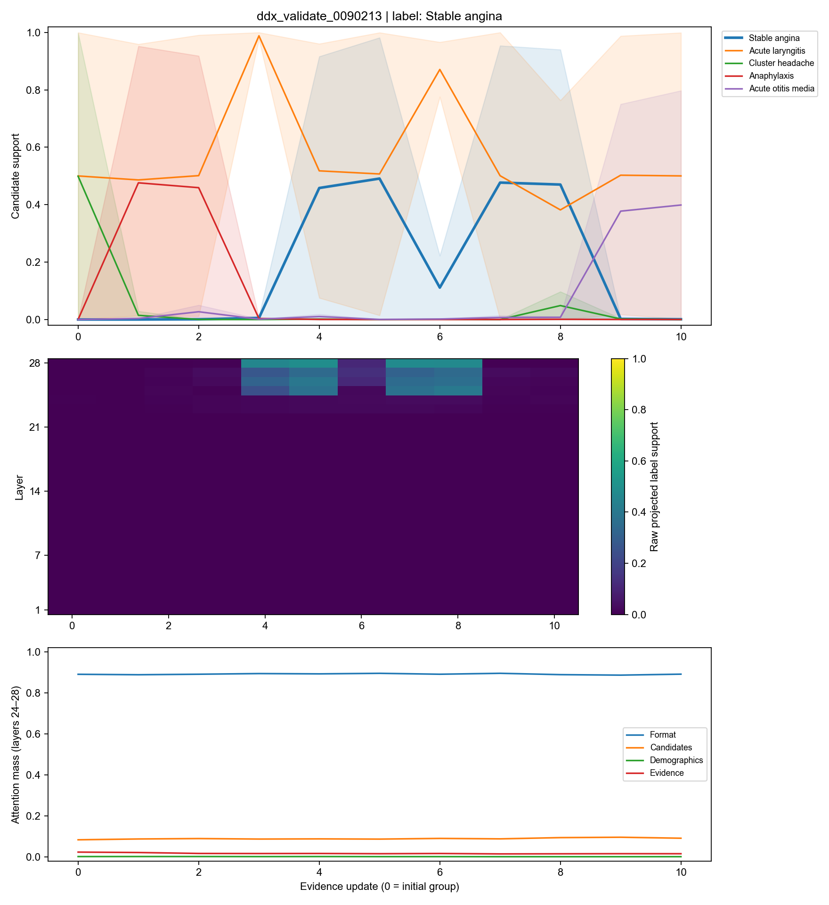

# ddx_validate_0090213

源标签：**Stable angina**；参考首位：**Unstable angina**。

实线为两个编码的平均分，阴影为两编码范围；逐层热图为原始投影，注意力曲线为晚5层均值。终点评价使用三个编码，可能与此处两编码轨迹不同。

| 轮 | 新证据（原始英文） | 当前首选 | 标签支持 |
|---|---|---|---|
| 0 | Do you have pain somewhere, related to your reason for consulting? **Yes** Characterize your pain: **tedious; heavy; exhausting** Do you feel pain somewhere? **biceps(R); thyroid cartilage; side of the chest(R); side of the chest(L); upper chest** How intense is the pain? **Recorded scale value 3 on the dataset's 0-10 scale; endpoint meanings are unspecified** Does the pain radiate to another location? **biceps(L); thoracic spine; under the jaw; triceps(L)** How precisely is the pain located? **Recorded scale value 3 on the dataset's 0-10 scale; endpoint meanings are unspecified** How fast did the pain appear? **Recorded scale value 3 on the dataset's 0-10 scale; endpoint meanings are unspecified** | Acute laryngitis | 0.0000 |
| 1 | Do you have diabetes? **Yes** | Acute laryngitis | 0.0000 |
| 2 | Do you have symptoms that are increased with physical exertion but alleviated with rest? **Yes** | Acute laryngitis | 0.0007 |
| 3 | Do you exercise regularly, 4 times per week or more? **Yes** | Acute laryngitis | 0.0054 |
| 4 | Are you experiencing shortness of breath or difficulty breathing in a significant way? **Yes** | Acute laryngitis | 0.4581 |
| 5 | Do you have high blood pressure or do you take medications to treat high blood pressure? **Yes** | Acute laryngitis | 0.4910 |
| 6 | Do you constantly feel fatigued or do you have non-restful sleep? **Yes** | Acute laryngitis | 0.1111 |
| 7 | Do you have close family members who had a cardiovascular disease problem before the age of 50? **Yes** | Acute laryngitis | 0.4770 |
| 8 | Have you ever had a heart attack or do you have angina (chest pain)? **Yes** | Stable angina | 0.4701 |
| 9 | Do you have high cholesterol or do you take medications to treat high cholesterol? **Yes** | Acute laryngitis | 0.0021 |
| 10 | Have you traveled out of the country in the last 4 weeks? **No** | Acute laryngitis | 0.0008 |
