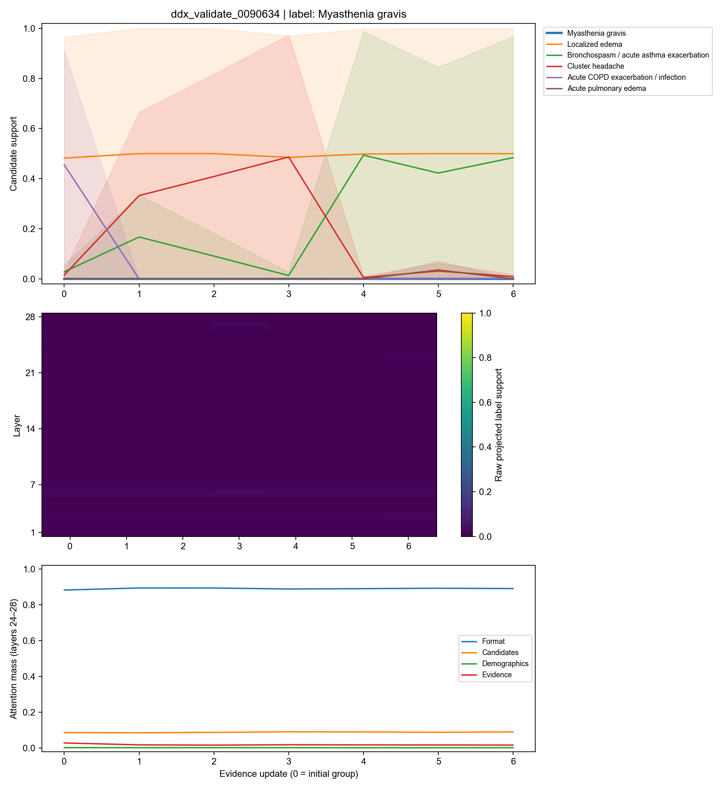

# ddx_validate_0090634

源标签：**Myasthenia gravis**；参考首位：**Myasthenia gravis**。

实线为两个编码的平均分，阴影为两编码范围；逐层热图为原始投影，注意力曲线为晚5层均值。终点评价使用三个编码，可能与此处两编码轨迹不同。

| 轮 | 新证据（原始英文） | 当前首选 | 标签支持 |
|---|---|---|---|
| 0 | Are you experiencing shortness of breath or difficulty breathing in a significant way? **Yes** | Localized edema | 0.0001 |
| 1 | Do you feel weakness in both arms and/or both legs? **Yes** | Localized edema | 0.0000 |
| 2 | Do your symptoms of muscle weakness increase with fatigue and/or stress? **Yes** | Localized edema | 0.0000 |
| 3 | Have you traveled out of the country in the last 4 weeks? **No** | Cluster headache | 0.0001 |
| 4 | Do you have difficulty articulating words/speaking? **Yes** | Localized edema | 0.0000 |
| 5 | Do you have the perception of seeing two images of a single object seen overlapping or adjacent to each other (double vision)? **Yes** | Localized edema | 0.0000 |
| 6 | Do you have a hard time opening/raising one or both eyelids? **Yes** | Localized edema | 0.0000 |
