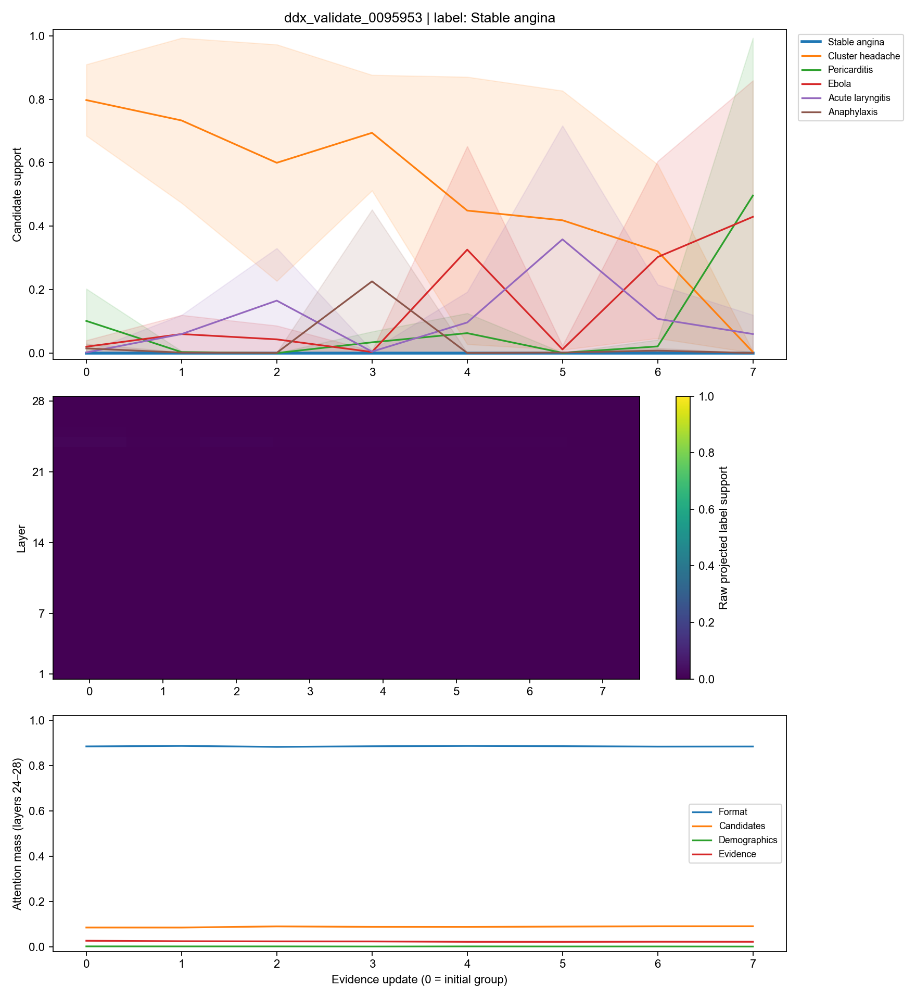

# ddx_validate_0095953

源标签：**Stable angina**；参考首位：**Unstable angina**。

实线为两个编码的平均分，阴影为两编码范围；逐层热图为原始投影，注意力曲线为晚5层均值。终点评价使用三个编码，可能与此处两编码轨迹不同。

| 轮 | 新证据（原始英文） | 当前首选 | 标签支持 |
|---|---|---|---|
| 0 | Do you have pain somewhere, related to your reason for consulting? **Yes** Characterize your pain: **heavy; exhausting** Do you feel pain somewhere? **side of the chest(L); posterior chest wall(R); triceps(R); triceps(L)** How intense is the pain? **Recorded scale value 4 on the dataset's 0-10 scale; endpoint meanings are unspecified** Does the pain radiate to another location? **biceps(L); thoracic spine; under the jaw; triceps(L); shoulder(R)** How precisely is the pain located? **Recorded scale value 4 on the dataset's 0-10 scale; endpoint meanings are unspecified** How fast did the pain appear? **Recorded scale value 4 on the dataset's 0-10 scale; endpoint meanings are unspecified** | Cluster headache | 0.0000 |
| 1 | Have you traveled out of the country in the last 4 weeks? **No** | Cluster headache | 0.0000 |
| 2 | Do you smoke cigarettes? **Yes** | Cluster headache | 0.0000 |
| 3 | Do you have close family members who had a cardiovascular disease problem before the age of 50? **Yes** | Cluster headache | 0.0000 |
| 4 | Do you drink alcohol excessively or do you have an addiction to alcohol? **Yes** | Cluster headache | 0.0000 |
| 5 | Are you significantly overweight compared to people of the same height as you? **Yes** | Cluster headache | 0.0000 |
| 6 | Do you have high blood pressure or do you take medications to treat high blood pressure? **Yes** | Cluster headache | 0.0000 |
| 7 | Do you have symptoms that are increased with physical exertion but alleviated with rest? **Yes** | Pericarditis | 0.0000 |
