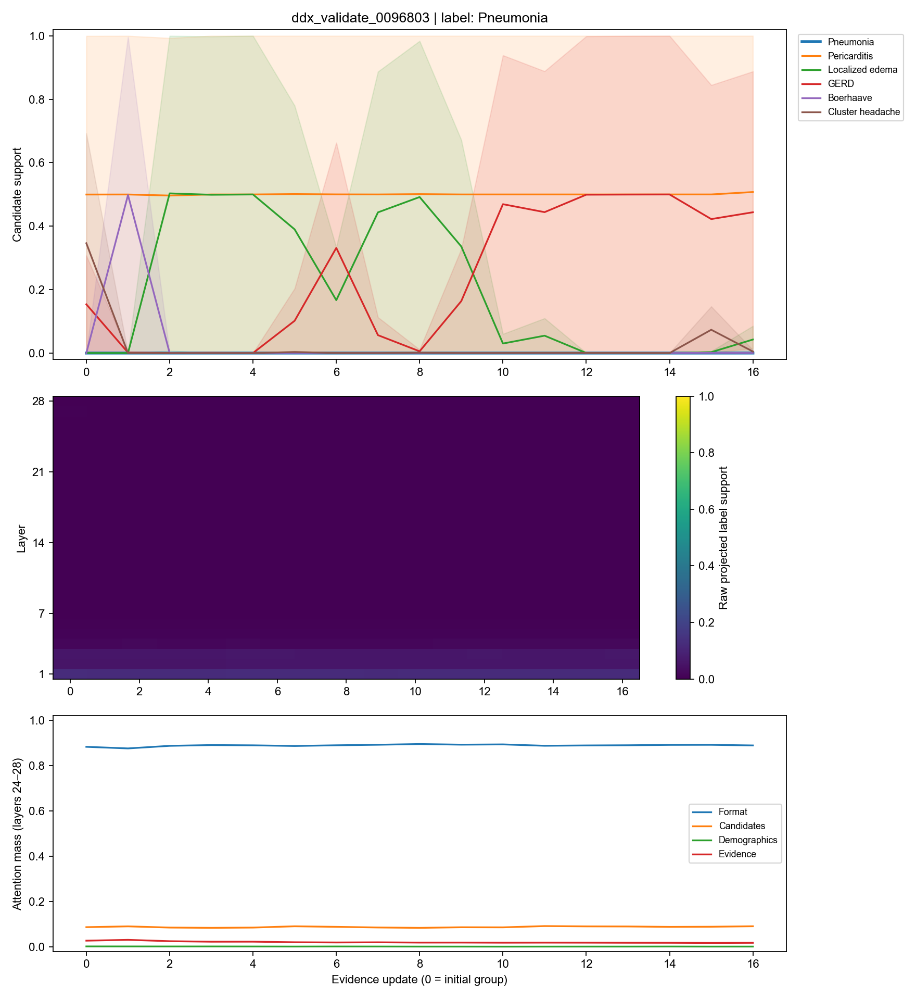

# ddx_validate_0096803

源标签：**Pneumonia**；参考首位：**Pneumonia**。

实线为两个编码的平均分，阴影为两编码范围；逐层热图为原始投影，注意力曲线为晚5层均值。终点评价使用三个编码，可能与此处两编码轨迹不同。

| 轮 | 新证据（原始英文） | 当前首选 | 标签支持 |
|---|---|---|---|
| 0 | Do you have pain somewhere, related to your reason for consulting? **Yes** Characterize your pain: **sharp** Do you feel pain somewhere? **side of the chest(L); breast(R); breast(L); posterior chest wall(R)** How intense is the pain? **Recorded scale value 7 on the dataset's 0-10 scale; endpoint meanings are unspecified** Does the pain radiate to another location? **nowhere** How precisely is the pain located? **Recorded scale value 1 on the dataset's 0-10 scale; endpoint meanings are unspecified** How fast did the pain appear? **Recorded scale value 1 on the dataset's 0-10 scale; endpoint meanings are unspecified** | Pericarditis | 0.0000 |
| 1 | Have you been coughing up blood? **Yes** | Pericarditis | 0.0000 |
| 2 | Do you have heart failure? **Yes** | Localized edema | 0.0000 |
| 3 | Do you smoke cigarettes? **Yes** | Pericarditis | 0.0000 |
| 4 | Have you ever had pneumonia? **Yes** | Pericarditis | 0.0000 |
| 5 | Do you have diffuse (widespread) muscle pain? **Yes** | Pericarditis | 0.0000 |
| 6 | Have you had surgery within the last month? **Yes** | Pericarditis | 0.0000 |
| 7 | Have you traveled out of the country in the last 4 weeks? **No** | Pericarditis | 0.0000 |
| 8 | Have you ever had a stroke? **Yes** | Pericarditis | 0.0000 |
| 9 | Do you have Parkinson’s disease? **Yes** | Pericarditis | 0.0000 |
| 10 | Are your vaccinations up to date? **Yes** | Pericarditis | 0.0000 |
| 11 | Do you have any lesions, redness or problems on your skin that you believe are related to the condition you are consulting for? **Yes** What color is the rash? **pink** Do your lesions peel off? **Yes** Is the rash swollen? **Recorded scale value 1 on the dataset's 0-10 scale; endpoint meanings are unspecified** Where is the affected region located? **side of the neck(R); side of the neck(L); posterior chest wall(L); belly** How intense is the pain caused by the rash? **Recorded scale value 2 on the dataset's 0-10 scale; endpoint meanings are unspecified** Is the lesion (or are the lesions) larger than 1cm? **No** How severe is the itching? **Recorded scale value 5 on the dataset's 0-10 scale; endpoint meanings are unspecified** | Pericarditis | 0.0000 |
| 12 | Do you have a fever (either felt or measured with a thermometer)? **Yes** | Pericarditis | 0.0000 |
| 13 | Do you have a cough? **Yes** | Pericarditis | 0.0000 |
| 14 | Do you have a cough that produces colored or more abundant sputum than usual? **Yes** | Pericarditis | 0.0000 |
| 15 | Have you had chills or shivers? **Yes** | Pericarditis | 0.0000 |
| 16 | Are you experiencing shortness of breath or difficulty breathing in a significant way? **Yes** | Pericarditis | 0.0001 |
