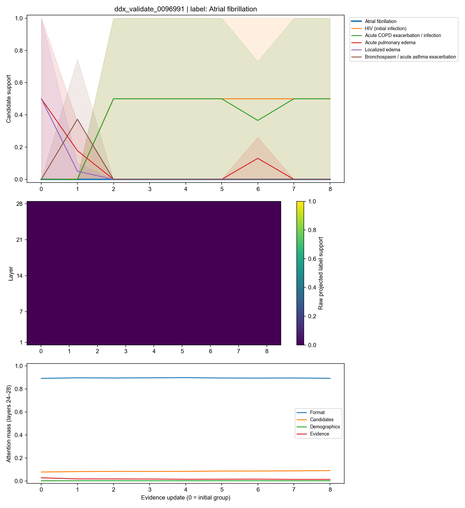

# ddx_validate_0096991

源标签：**Atrial fibrillation**；参考首位：**Atrial fibrillation**。

实线为两个编码的平均分，阴影为两编码范围；逐层热图为原始投影，注意力曲线为晚5层均值。终点评价使用三个编码，可能与此处两编码轨迹不同。

| 轮 | 新证据（原始英文） | 当前首选 | 标签支持 |
|---|---|---|---|
| 0 | Are you experiencing shortness of breath or difficulty breathing in a significant way? **Yes** | Acute pulmonary edema | 0.0000 |
| 1 | Do you have high blood pressure or do you take medications to treat high blood pressure? **Yes** | Bronchospasm / acute asthma exacerbation | 0.0000 |
| 2 | Do you have severe Chronic Obstructive Pulmonary Disease (COPD)? **Yes** | HIV (initial infection) | 0.0000 |
| 3 | Have you been diagnosed with hyperthyroidism? **Yes** | HIV (initial infection) | 0.0000 |
| 4 | Do you feel your heart is beating very irregularly or in a disorganized pattern? **Yes** | HIV (initial infection) | 0.0000 |
| 5 | Do you have diabetes? **Yes** | HIV (initial infection) | 0.0000 |
| 6 | Do you have a known issue with one of your heart valves? **Yes** | HIV (initial infection) | 0.0000 |
| 7 | Have you ever had a heart attack or do you have angina (chest pain)? **Yes** | HIV (initial infection) | 0.0000 |
| 8 | Have you traveled out of the country in the last 4 weeks? **No** | HIV (initial infection) | 0.0000 |
