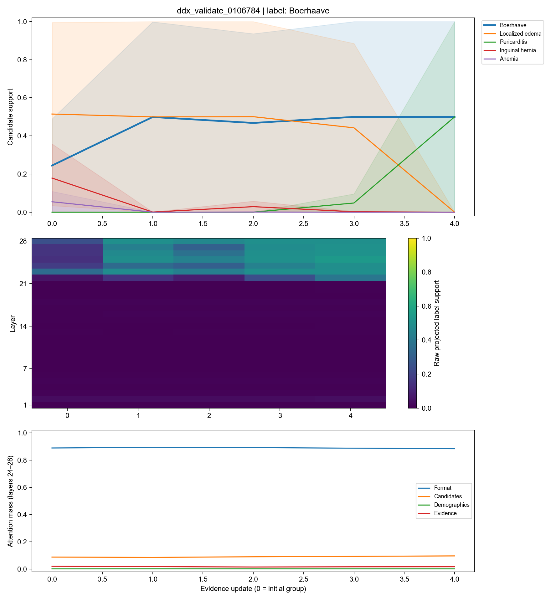

# ddx_validate_0106784

源标签：**Boerhaave**；参考首位：**Boerhaave**。

实线为两个编码的平均分，阴影为两编码范围；逐层热图为原始投影，注意力曲线为晚5层均值。终点评价使用三个编码，可能与此处两编码轨迹不同。

| 轮 | 新证据（原始英文） | 当前首选 | 标签支持 |
|---|---|---|---|
| 0 | Have you vomited several times or have you made several efforts to vomit? **Yes** | Localized edema | 0.2448 |
| 1 | Are you feeling nauseous or do you feel like vomiting? **Yes** | Localized edema | 0.4992 |
| 2 | Do you drink alcohol excessively or do you have an addiction to alcohol? **Yes** | Localized edema | 0.4681 |
| 3 | Have you traveled out of the country in the last 4 weeks? **No** | Boerhaave | 0.5000 |
| 4 | Do you have pain somewhere, related to your reason for consulting? **Yes** Characterize your pain: **heartbreaking; a knife stroke; violent; sickening** Do you feel pain somewhere? **lower chest; flank(R); upper chest; epigastric** How intense is the pain? **Recorded scale value 8 on the dataset's 0-10 scale; endpoint meanings are unspecified** Does the pain radiate to another location? **thoracic spine; scapula(L)** How precisely is the pain located? **Recorded scale value 4 on the dataset's 0-10 scale; endpoint meanings are unspecified** How fast did the pain appear? **Recorded scale value 8 on the dataset's 0-10 scale; endpoint meanings are unspecified** | Boerhaave | 0.5000 |
