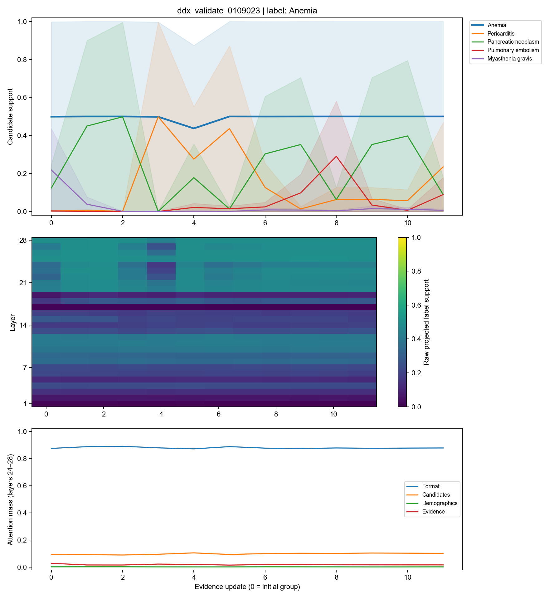

# ddx_validate_0109023

源标签：**Anemia**；参考首位：**Anemia**。

实线为两个编码的平均分，阴影为两编码范围；逐层热图为原始投影，注意力曲线为晚5层均值。终点评价使用三个编码，可能与此处两编码轨迹不同。

| 轮 | 新证据（原始英文） | 当前首选 | 标签支持 |
|---|---|---|---|
| 0 | Have you recently had stools that were black (like coal)? **Yes** | Anemia | 0.4991 |
| 1 | Do you feel so tired that you are unable to do your usual activities or are you stuck in your bed all day long? **Yes** | Anemia | 0.5000 |
| 2 | Is your skin much paler than usual? **Yes** | Anemia | 0.5000 |
| 3 | Do you have pain somewhere, related to your reason for consulting? **Yes** Characterize your pain: **sensitive; tugging; a cramp** Do you feel pain somewhere? **back of head; forehead; temple(R); temple(L)** How intense is the pain? **Recorded scale value 1 on the dataset's 0-10 scale; endpoint meanings are unspecified** Does the pain radiate to another location? **nowhere** How precisely is the pain located? **Recorded scale value 3 on the dataset's 0-10 scale; endpoint meanings are unspecified** How fast did the pain appear? **Recorded scale value 5 on the dataset's 0-10 scale; endpoint meanings are unspecified** | Anemia | 0.4985 |
| 4 | Do you have chronic kidney failure? **Yes** | Anemia | 0.4371 |
| 5 | Are you taking any new oral anticoagulants ((NOACs)? **Yes** | Anemia | 0.5000 |
| 6 | Have you ever had a diagnosis of anemia? **Yes** | Anemia | 0.4997 |
| 7 | Do you have any family members who have been diagnosed with anemia? **Yes** | Anemia | 0.4999 |
| 8 | Do you have a poor diet? **Yes** | Anemia | 0.5000 |
| 9 | Do you constantly feel fatigued or do you have non-restful sleep? **Yes** | Anemia | 0.5000 |
| 10 | Are you experiencing shortness of breath or difficulty breathing in a significant way? **Yes** | Anemia | 0.5000 |
| 11 | Have you traveled out of the country in the last 4 weeks? **Central America** | Anemia | 0.5000 |
