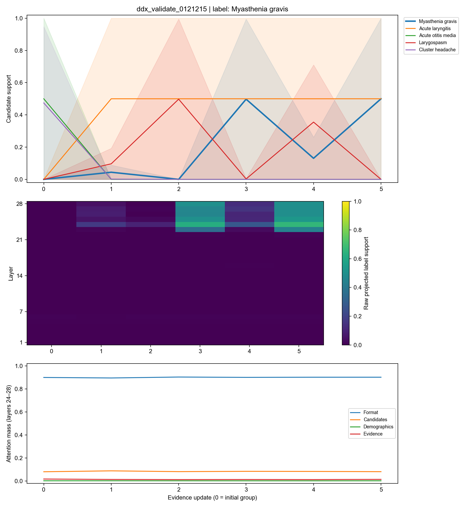

# ddx_validate_0121215

源标签：**Myasthenia gravis**；参考首位：**Myasthenia gravis**。

实线为两个编码的平均分，阴影为两编码范围；逐层热图为原始投影，注意力曲线为晚5层均值。终点评价使用三个编码，可能与此处两编码轨迹不同。

| 轮 | 新证据（原始英文） | 当前首选 | 标签支持 |
|---|---|---|---|
| 0 | Do you have pain or weakness in your jaw? **Yes** | Acute otitis media | 0.0000 |
| 1 | Are there any members of your family who have been diagnosed myasthenia gravis? **Yes** | Acute laryngitis | 0.0441 |
| 2 | Do you have difficulty swallowing, or have a feeling of discomfort/blockage when swallowing? **Yes** | Acute laryngitis | 0.0000 |
| 3 | Have you traveled out of the country in the last 4 weeks? **No** | Acute laryngitis | 0.4975 |
| 4 | Do you have difficulty articulating words/speaking? **Yes** | Acute laryngitis | 0.1307 |
| 5 | Do you have the perception of seeing two images of a single object seen overlapping or adjacent to each other (double vision)? **Yes** | Acute laryngitis | 0.4999 |
