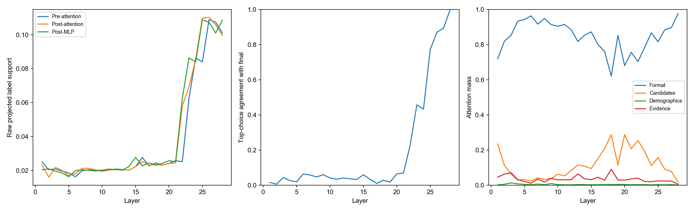
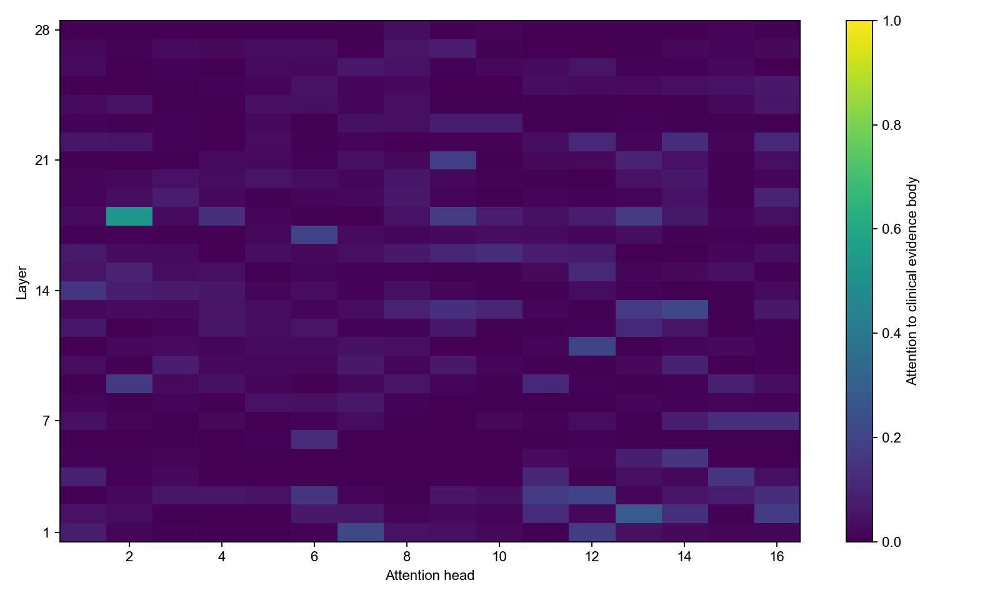

# 阶段07：证据进入后，各层和注意力怎样变化

## 测量

每个观测点保留28层诊断位置的进入状态、注意力增量、注意力后状态、MLP增量和离层状态；在进入、注意力后、离层三处投影为49疾病分数。每层16个注意力头分别记录它对模板、候选、人口信息与每组证据的注意力。固定24例另保存逐token注意力、各头输出及各证据末位置状态。参数不在轮间训练；变化的是输入导致的激活与注意力。

以下总体分析采用基础顺序、两编码，每例内部先平均。逐层分数是原始输出头读出，尚未经49病独立读出校准。

## 结果

第27层与最终层首选不同的轮次比例：5.52% [4.36, 6.87]。出现“24—27层一致、末层转向”且两个编码同时支持同一疾病对的病例为 **0/120**。这直接检验早期个案能否跨编码复现。

晚5层注意力平均分配：证据正文1.91% [1.84, 1.98]，候选列表9.10% [8.99, 9.21]，模板88.79% [88.66, 88.93]，人口信息0.20% [0.19, 0.20]。证据标题被归入模板；证据正文保留全部明确记录的问答。组总质量和每token密度同时输出，避免把更长证据误当作更受重视。

模板位置的隐藏状态也可能已整合前面的病例信息。上述比例测的是“此头直接连向哪些位置”，不是医学信息的总贡献；注意力到模板较多，不能直接解释为忽略患者。

每例内，“新增证据的每token注意力”与“本轮疾病分布改变量”的Spearman相关系数，病例均值为 **0.2576 [0.1731, 0.3356]**。这是关联测量，因果作用由阶段08干预检验。

## 数值检查

5040次观测；56次完整原生前向对照全部通过：True。重建注意力加权输出相对RMS误差最大0.000279。无约束首token落在候选外的观测0次。模型权重前后哈希一致。

## 结论

**现在能逐轮定位疾病分数在何层变化，也能量化每个头把注意力分给了哪些证据。** 这些记录将表面的改诊与内部计算连起来；原始读出差异本身仍不能证明某层拥有一个独立且正确的诊断。阶段08测试把特定内部计算换回前轮后，最终判断是否随之改变。

[逐层数据](layer_metrics.csv) · [逐层注意力数据](attention_metrics.csv) · [结果汇总](summary.json) · [病例图谱](../06_full_candidate_trajectories/CASE_ATLAS.md)

## 全量交付复核

5578个新观测的状态文件、概率和哈希已全量核对。编码条件中，批量逐层投影与单点末层输出的最大候选支持差为0.007628；5040次首选均一致。该差来自FP16批量/单点数值路径，终点行为统计使用单点输出，逐层图使用批量投影。对齐检验沿用冻结观测脚本的logit容差，没有改写原始结果。详见[交付审计](../../protocol/FULL49_DELIVERY_VERIFICATION.json)。
