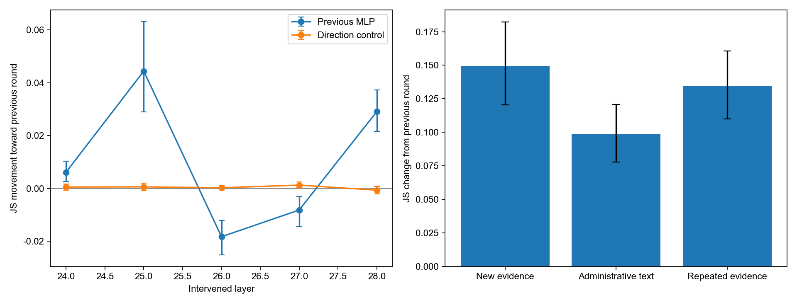

# 阶段08：旧计算是否推动模型回到前轮判断

## 方法

120例的固定中间轮、两个编码，共240个前缀。分别在24—28层替换诊断位置的注意力增量或MLP增量，替换来源为同病例前轮。方向对照将相同差向量沿隐藏维度循环移位257位，保留范数；自身替换检查数值误差。其他输入事实保持当前轮不变，计算后续层输出。

主要指标：JS(当前分布,前轮分布) − JS(干预分布,前轮分布)。正值表示向前轮靠近，负值表示远离；前轮不一定正确。报告原替换效应和减去方向对照后的效应。先病例内平均编码，再计算病例bootstrap区间。26、27、28层三个预定检验使用双侧t检验与Holm校正。

## 干预结果

| 层 | 旧MLP替换：向前轮靠近量 [95%区间] | 减去方向对照后的效应 [95%区间] |
|---|---|---|
| 24 | 0.0061 [0.0027, 0.0103] | 0.0056 [0.0023, 0.0093] |
| 25 | 0.0444 [0.0290, 0.0632] | 0.0438 [0.0281, 0.0631] |
| 26 | -0.0183 [-0.0251, -0.0122] | -0.0185 [-0.0255, -0.0124] |
| 27 | -0.0082 [-0.0145, -0.0030] | -0.0094 [-0.0159, -0.0042] |
| 28 | 0.0292 [0.0216, 0.0373] | 0.0298 [0.0221, 0.0383] |

| 层 | 预定方向 | 相对方向对照的均值 | Holm校正p | 结论 |
|---|---|---|---|---|
| 26 | 负 | -0.018543 | 1.6606e-07 | 确认 |
| 27 | 负 | -0.009439 | 0.00089444 | 确认 |
| 28 | 正 | +0.029841 | 5.2444e-11 | 确认 |

**三个预定层的方向模式在新病例中得到确认。** 共1200个前缀×层记录，179个未通过自身替换数值检查，被排除于效应分析；原始记录全部保留。每层有效病例数和编码数在数据表中单列。

探索性敏感性分析保留所有记录：第26、27、28层相对方向对照效应分别为-0.0198 [-0.0269, -0.0136]、-0.0092 [-0.0148, -0.0044]、0.0298 [0.0223, 0.0384]。它用于判断数值排除的影响，不替代预定主要分析。

## 非医学新增内容

同一前轮分别追加真实新证据、行政记录说明或重复初始证据；后两者不增加新的临床事实。其疾病分布变化JS为：

| 追加内容 | 改变量 [95%区间] | 首选改变率 [95%区间] | 平均新增token |
|---|---|---|---|
| 真实新证据 | 0.1496 [0.1204, 0.1822] | 30.83% [25.00, 37.09] | 42.8 |
| 行政说明 | 0.0987 [0.0777, 0.1208] | 22.50% [17.08, 27.92] | 34.0 |
| 重复初始证据 | 0.1344 [0.1099, 0.1605] | 28.33% [22.92, 34.17] | 64.6 |

真实减行政的JS差为0.0509 [0.0191, 0.0832]，真实减重复的差为0.0152 [-0.0209, 0.0493]。自然文本长度未严格匹配，因此这些对比测量不同输入条件的敏感性，不单独分离语义与长度。

## 解释范围

本轮确认的是冻结1.7B模型、49疾病编码接口中诊断位置的局部计算作用。替换具有因果意义，但跨轮状态替换并非自然医学证据编辑；恢复前轮也不等于改善诊断。是否能用疾病名及更自然的证据干预复现，将决定它能否上升为医学信念机制。

[干预逐病例数据](case_interventions.csv) · [内容逐病例数据](content_case_metrics.csv) · [精确结果](summary.json) · [数值排除记录](numerical_exclusions.json)
