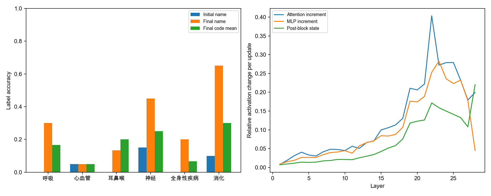

# 阶段09：从字母选项转向完整疾病名

## 研究修正

49字母接口混入了显著的疾病—字母绑定问题。此处保留同一批病例和49候选，直接填写完整疾病名。固定JSON前缀后，计算每个规范名及闭合符号、EOS的完整序列概率，再在49病之间归一化；同时保留实际贪心续写。它是完整名称的模型支持，不是把“Acute”等首词当作一个疾病。

120例测初始、中间、终点；预定24例追踪全部基础顺序轮次并复查逆序、乱序终点，共538次观测。全部观测捕获28层五处激活和16个头的证据注意力；24例保留逐token记录。该阶段是在看到编码接口问题后进行的探索性修正。

## 总体结果

完整名称评分的标签命中从初始 **5.00% [1.67, 9.17]**，变为中间 **22.50% [15.83, 30.00]**，最终 **30.83% [22.50, 39.17]**。同病例字母接口终点为17.50% [10.83, 24.17]；名称减编码的病例配对准确率差为13.33% [4.17, 22.50]。两接口同时改变列表展示和输出方式，此差不单独归因于某个字符。

| 疾病组 | n | 初始名称命中 | 中间名称命中 | 最终名称命中 | 最终编码命中 |
|---|---|---|---|---|---|
| 呼吸 | 30 | 0.0% | 20.0% | 30.0% | 16.7% |
| 心血管 | 20 | 5.0% | 0.0% | 5.0% | 5.0% |
| 耳鼻喉 | 15 | 0.0% | 6.7% | 13.3% | 20.0% |
| 神经 | 20 | 15.0% | 30.0% | 45.0% | 25.0% |
| 全身性疾病 | 15 | 0.0% | 20.0% | 20.0% | 6.7% |
| 消化 | 20 | 10.0% | 55.0% | 65.0% | 30.0% |

24例完整轨迹中，曾命中标签后偏离的病例比例为29.17% [12.50, 45.83]；相同终点事实仅将新增证据逆序，首选改变50.00% [29.17, 70.83]；独立乱序改变37.50% [20.83, 58.33]。仅反转候选列表时改变50.00% [29.17, 70.83]，该项与证据顺序单独报告。

终点首选未命中标签但候选支持≥0.9的病例比例为29.17% [21.65, 37.50]；首选不在源参考鉴别分布支持集中且支持≥0.9的比例为18.33% [11.67, 25.83]。这两项描述候选分数的集中与参考不一致，不把生成概率直接当成医学置信度。

按源数据的既往史标记划分：病史类86次新增证据，当前表现类92次。病例内先分别平均，再跨病例汇总，疾病分布JS变化为病史类0.1608 [0.1106, 0.2129]、当前表现类0.1940 [0.1364, 0.2597]。两类临床信息强度并不匹配，该分层用于描述；明确提及既往诊断或治疗的证据保留原文，不将顺着这种提示选对疾病当成机制创新。

## 内部究竟测到了什么

每轮新证据都会产生一套新的层内状态。这里保存了每层注意力贡献、MLP贡献及最终状态的真实向量，计算它们相对前轮的大小变化和方向变化。固定24例内，“晚层状态方向变化”与“疾病名分布变化”的Spearman相关，病例均值为0.6385 [0.5235, 0.7419]。

作为因果遮罩的架构检查，相同初始证据末位置的状态，在追加后续证据后最大相对变化为0.004492。早期token不能看未来；医学更新的主要观测位置是读完当轮所有证据后的诊断位置，而不是声称模型回头改写了旧token或模型权重。

**这说明可以把外部诊断轨迹与内部状态轨迹逐轮对应起来。它是否推动某个疾病的支持，需要阶段10的定向替换验证。** 本阶段不将一个隐藏向量的移动直接命名成某种疾病，也不将逐层权重说成在推理时重新训练。

## 名称评分质量

终点贪心输出能严格解析为指定JSON且疾病名属于49候选的比例为68.33% [60.00, 76.67]；名称最大序列分数与贪心诊断一致67.50% [59.17, 75.83]。所有观测中，49条规范完整字符串的概率总质量中位数为0.9799，低于0.1的有81/538次；总质量低时，候选归一化分数需结合自由续写阅读。

完整序列评分与每token平均评分的终点首选一致率88.33% [82.50, 93.33]；两者为不同评分定义。执行16次缓存与完整前向序列分数对照，最大对数分差0.03120。

[24例完整证据与图谱](CASE_ATLAS.md) · [120例结果](case_metrics.csv) · [逐证据转移](evidence_transitions.csv) · [逐层激活变化](activation_transitions.csv) · [精确汇总](summary.json)
