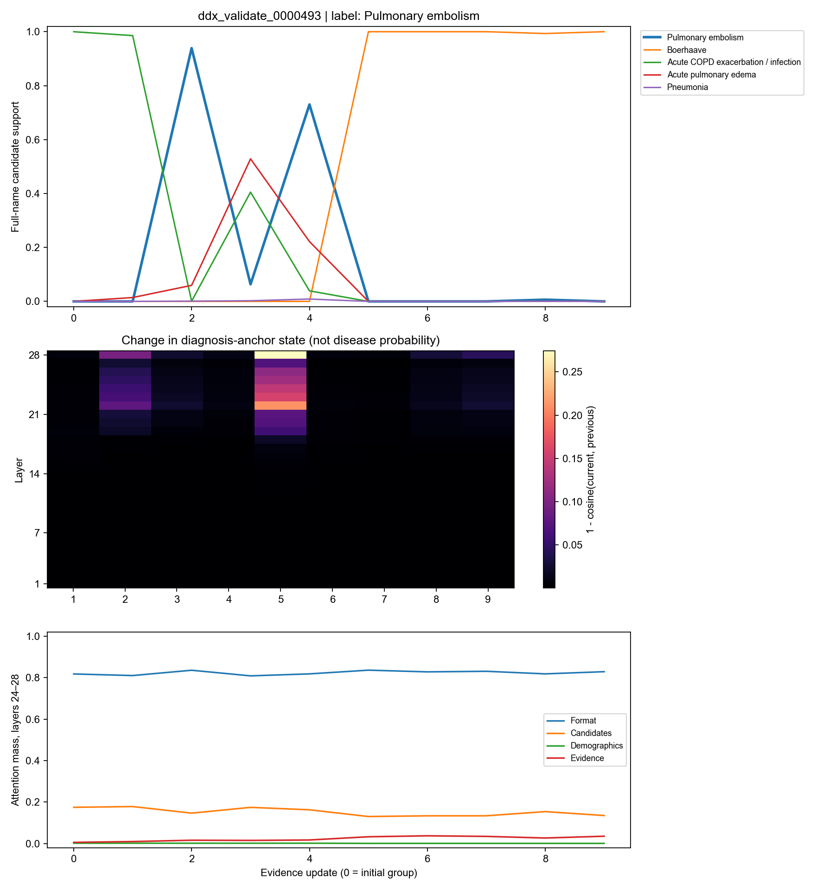

# ddx_validate_0000493

源标签：**Pulmonary embolism**；参考首位：**Pulmonary embolism**。

上图为完整疾病名的候选分数，中图为真实隐藏状态的方向变化，下图为注意力分配。中图颜色不代表某个疾病。

| 轮 | 新证据 | 名称评分首选 | 标签支持 | 贪心续写 |
|---|---|---|---|---|
| 0 | Did you lose consciousness? **Yes** | Acute COPD exacerbation / infection | 0.0000 | Acute COPD exacerbation / infection |
| 1 | Do you have an active cancer? **Yes** | Acute COPD exacerbation / infection | 0.0000 | Acute COPD exacerbation / infection |
| 2 | Have you ever had deep vein thrombosis (DVT)? **Yes** | Pulmonary embolism | 0.9389 | Pulmonary embolism |
| 3 | Have you had surgery within the last month? **Yes** | Acute pulmonary edema | 0.0635 | Acute pulmonary edema |
| 4 | Have you been unable to move or get up for more than 3 consecutive days within the last 4 weeks? **Yes** | Pulmonary embolism | 0.7301 | Pulmonary embolism |
| 5 | Do you have pain somewhere, related to your reason for consulting? **Yes** Characterize your pain: **a knife stroke; sharp** Do you feel pain somewhere? **side of the chest(R); scapula(R); breast(L); posterior chest wall(R); posterior chest wall(L)** How intense is the pain? **Recorded scale value 1 on the dataset's 0-10 scale; endpoint meanings are unspecified** Does the pain radiate to another location? **side of the chest(R); side of the chest(L); scapula(L); breast(R); posterior chest wall(R)** How precisely is the pain located? **Recorded scale value 9 on the dataset's 0-10 scale; endpoint meanings are unspecified** How fast did the pain appear? **Recorded scale value 7 on the dataset's 0-10 scale; endpoint meanings are unspecified** | Boerhaave | 0.0000 | Boerhaave |
| 6 | Do you have pain that is increased when you breathe in deeply? **Yes** | Boerhaave | 0.0000 | Boerhaave |
| 7 | Have you traveled out of the country in the last 4 weeks? **North America** | Boerhaave | 0.0000 | Boerhaave |
| 8 | Do you currently take hormones? **Yes** | Boerhaave | 0.0064 | Boerhaave |
| 9 | Do you have swelling in one or more areas of your body? **Yes** Where is the swelling located? **calf(R); calf(L)** | Boerhaave | 0.0000 | Boerhaave |
