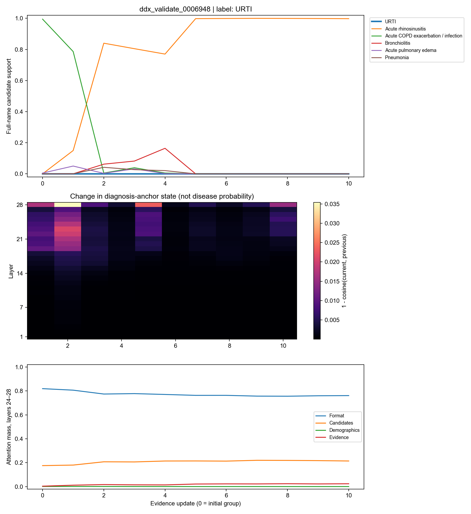

# ddx_validate_0006948

源标签：**URTI**；参考首位：**URTI**。

上图为完整疾病名的候选分数，中图为真实隐藏状态的方向变化，下图为注意力分配。中图颜色不代表某个疾病。

| 轮 | 新证据 | 名称评分首选 | 标签支持 | 贪心续写 |
|---|---|---|---|---|
| 0 | Have you had significantly increased sweating? **Yes** | Acute COPD exacerbation / infection | 0.0000 | Acute COPD exacerbation / infection |
| 1 | Do you have diffuse (widespread) muscle pain? **Yes** | Acute COPD exacerbation / infection | 0.0000 | Acute bronchiolitis |
| 2 | Do you have pain somewhere, related to your reason for consulting? **Yes** Characterize your pain: **tedious; heavy** Do you feel pain somewhere? **cheek(R); cheek(L); occiput; temple(L)** How intense is the pain? **Recorded scale value 2 on the dataset's 0-10 scale; endpoint meanings are unspecified** Does the pain radiate to another location? **nowhere** How precisely is the pain located? **Recorded scale value 2 on the dataset's 0-10 scale; endpoint meanings are unspecified** How fast did the pain appear? **Recorded scale value 2 on the dataset's 0-10 scale; endpoint meanings are unspecified** | Acute rhinosinusitis | 0.0000 | Acute bronchiolitis |
| 3 | Do you smoke cigarettes? **Yes** | Acute rhinosinusitis | 0.0000 | Acute bronchiolitis |
| 4 | Do you attend or work in a daycare? **Yes** | Acute rhinosinusitis | 0.0000 | Acute bronchiolitis |
| 5 | Do you have nasal congestion or a clear runny nose? **Yes** | Acute rhinosinusitis | 0.0000 | Acute rhinosinusitis |
| 6 | Do you live with 4 or more people? **Yes** | Acute rhinosinusitis | 0.0000 | Acute rhinosinusitis |
| 7 | Have you been in contact with a person with similar symptoms in the past 2 weeks? **Yes** | Acute rhinosinusitis | 0.0000 | Acute rhinosinusitis |
| 8 | Have you traveled out of the country in the last 4 weeks? **No** | Acute rhinosinusitis | 0.0000 | Acute rhinosinusitis |
| 9 | Do you have a sore throat? **Yes** | Acute rhinosinusitis | 0.0000 | Acute rhinosinusitis |
| 10 | Are you exposed to secondhand cigarette smoke on a daily basis? **Yes** | Acute rhinosinusitis | 0.0000 | Acute bronchiolitis |
