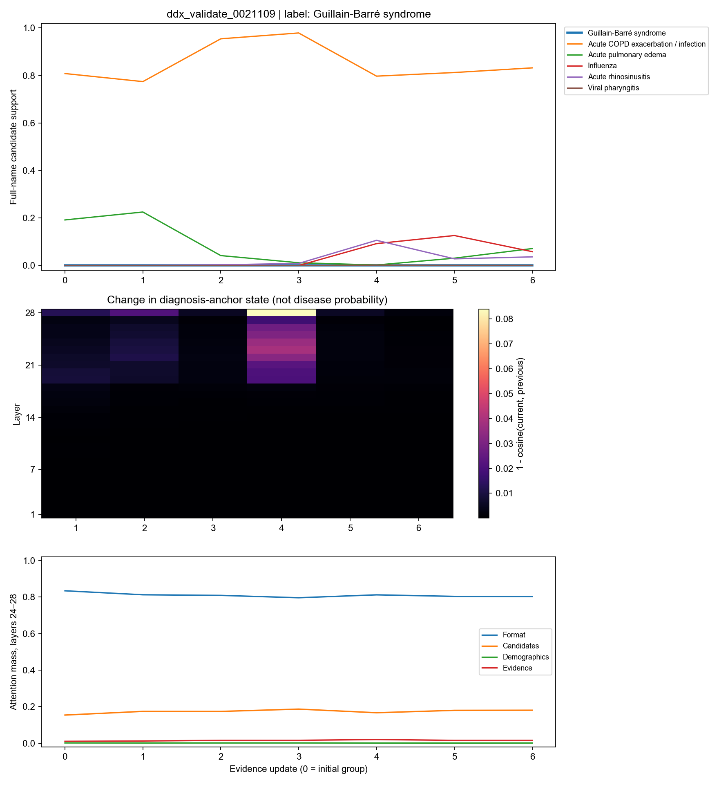

# ddx_validate_0021109

源标签：**Guillain-Barré syndrome**；参考首位：**Guillain-Barré syndrome**。

上图为完整疾病名的候选分数，中图为真实隐藏状态的方向变化，下图为注意力分配。中图颜色不代表某个疾病。

| 轮 | 新证据 | 名称评分首选 | 标签支持 | 贪心续写 |
|---|---|---|---|---|
| 0 | Are you experiencing shortness of breath or difficulty breathing in a significant way? **Yes** | Acute COPD exacerbation / infection | 0.0000 | Acute COPD exacerbation / infection |
| 1 | Do you currently, or did you ever, have numbness, loss of sensitivity or tingling anywhere on your body? **Yes** | Acute COPD exacerbation / infection | 0.0000 | Acute COPD exacerbation / infection |
| 2 | Have you noticed weakness in your facial muscles and/or eyes? **Yes** | Acute COPD exacerbation / infection | 0.0000 | Acute bronchiolitis |
| 3 | Have you traveled out of the country in the last 4 weeks? **No** | Acute COPD exacerbation / infection | 0.0000 | Acute bronchiolitis |
| 4 | Have you recently had a viral infection? **Yes** | Acute COPD exacerbation / infection | 0.0000 | Acute bronchiolitis |
| 5 | Do you feel weakness in both arms and/or both legs? **Yes** | Acute COPD exacerbation / infection | 0.0000 | Acute bronchiolitis |
| 6 | Have you recently had numbness, loss of sensation or tingling, in both arms and legs and around your mouth? **Yes** | Acute COPD exacerbation / infection | 0.0000 | Acute bronchiolitis |
