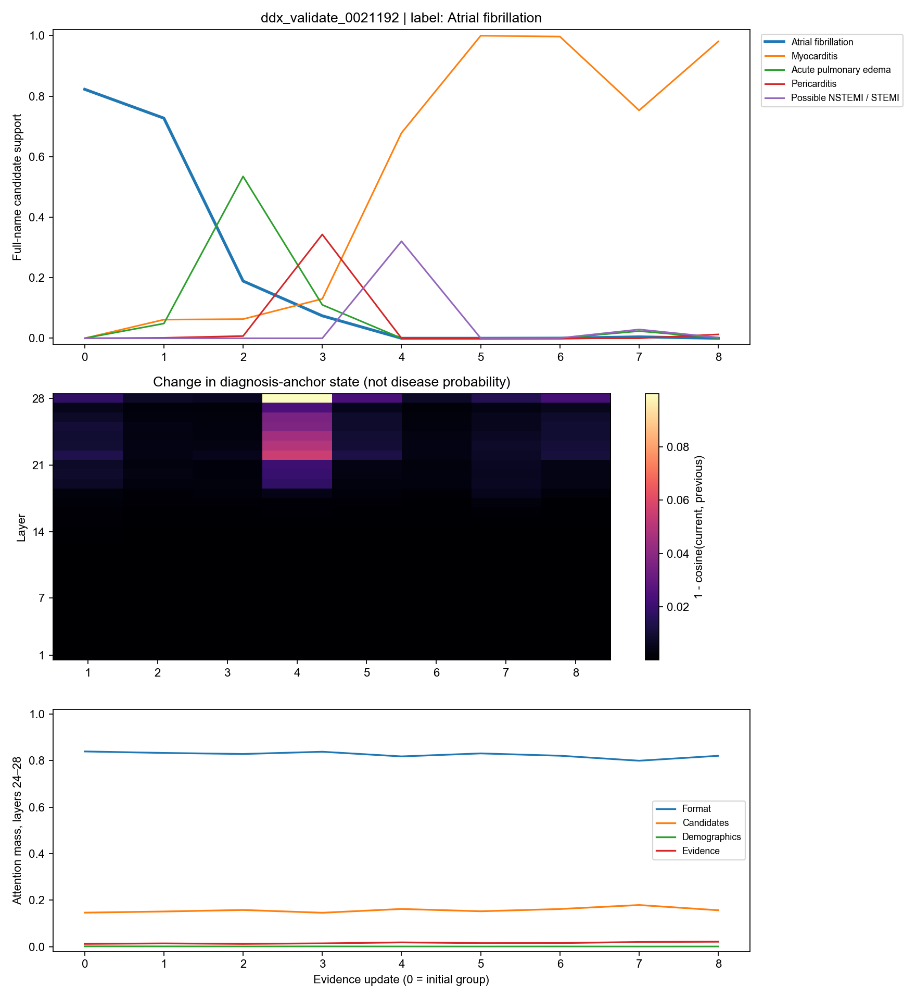

# ddx_validate_0021192

源标签：**Atrial fibrillation**；参考首位：**Atrial fibrillation**。

上图为完整疾病名的候选分数，中图为真实隐藏状态的方向变化，下图为注意力分配。中图颜色不代表某个疾病。

| 轮 | 新证据 | 名称评分首选 | 标签支持 | 贪心续写 |
|---|---|---|---|---|
| 0 | Do you feel your heart is beating very irregularly or in a disorganized pattern? **Yes** | Atrial fibrillation | 0.8225 | Atrial fibrillation |
| 1 | Do you have diabetes? **Yes** | Atrial fibrillation | 0.7271 | Atrial fibrillation |
| 2 | Do you feel slightly dizzy or lightheaded? **Yes** | Acute pulmonary edema | 0.1890 | Acute pulmonary edema |
| 3 | Are you significantly overweight compared to people of the same height as you? **Yes** | Pericarditis | 0.0742 | Panic attack |
| 4 | Have you ever had a heart attack or do you have angina (chest pain)? **Yes** | Myocarditis | 0.0000 | Myocarditis |
| 5 | Have you traveled out of the country in the last 4 weeks? **No** | Myocarditis | 0.0000 | Myocarditis |
| 6 | Do you feel your heart is beating fast (racing), irregularly (missing a beat) or do you feel palpitations? **Yes** | Myocarditis | 0.0004 | Myocarditis |
| 7 | Do you have severe Chronic Obstructive Pulmonary Disease (COPD)? **Yes** | Myocarditis | 0.0046 | Myocarditis |
| 8 | Do you have a known heart defect? **Yes** | Myocarditis | 0.0000 | Myocarditis |
