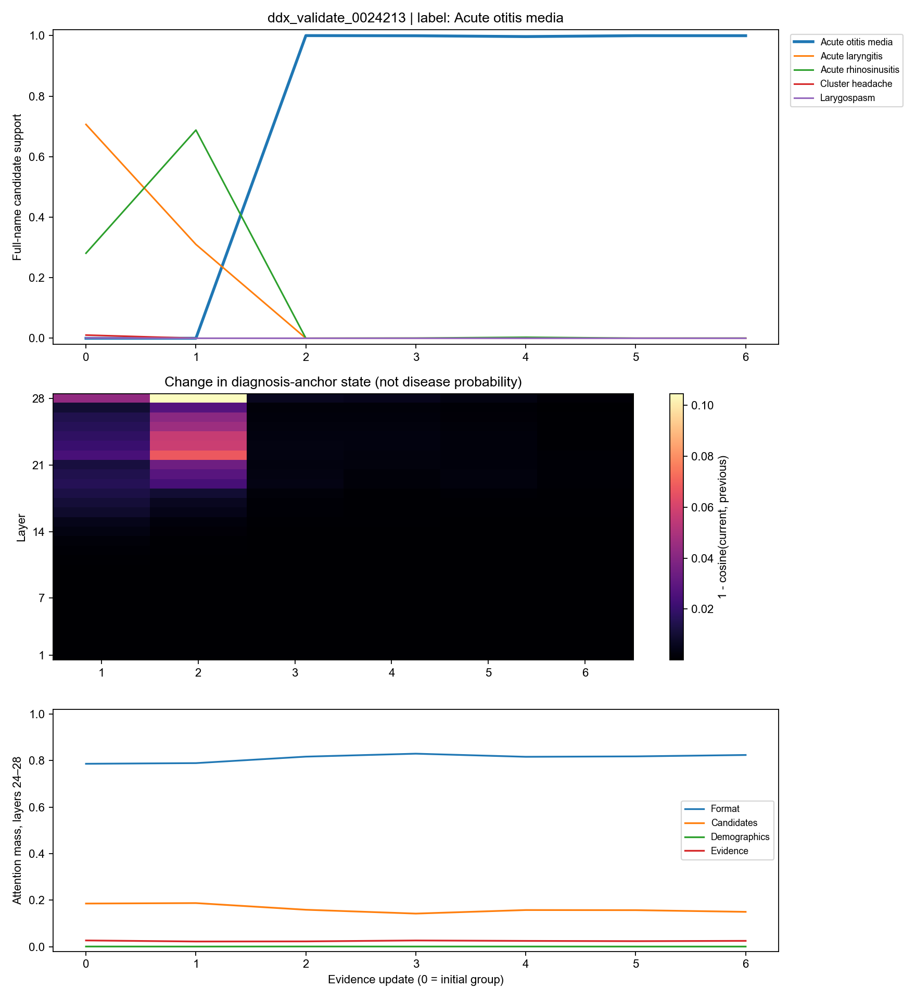

# ddx_validate_0024213

源标签：**Acute otitis media**；参考首位：**URTI**。

上图为完整疾病名的候选分数，中图为真实隐藏状态的方向变化，下图为注意力分配。中图颜色不代表某个疾病。

| 轮 | 新证据 | 名称评分首选 | 标签支持 | 贪心续写 |
|---|---|---|---|---|
| 0 | Do you have pain somewhere, related to your reason for consulting? **Yes** Characterize your pain: **sensitive; sharp** Do you feel pain somewhere? **ear(R)** How intense is the pain? **Recorded scale value 8 on the dataset's 0-10 scale; endpoint meanings are unspecified** Does the pain radiate to another location? **nowhere** How precisely is the pain located? **Recorded scale value 9 on the dataset's 0-10 scale; endpoint meanings are unspecified** How fast did the pain appear? **Recorded scale value 3 on the dataset's 0-10 scale; endpoint meanings are unspecified** | Acute laryngitis | 0.0000 | Acute laryngitis |
| 1 | Do you have a cough? **Yes** | Acute rhinosinusitis | 0.0000 | Acute rhinosinusitis |
| 2 | Are you currently being treated or have you recently been treated with an oral antibiotic for an ear infection? **Yes** | Acute otitis media | 0.9999 | Acute otitis media |
| 3 | Do you have nasal congestion or a clear runny nose? **Yes** | Acute otitis media | 0.9994 | Acute otitis media |
| 4 | Are you more irritable or has your mood been very unstable recently? **Yes** | Acute otitis media | 0.9967 | Acute otitis media |
| 5 | Have you traveled out of the country in the last 4 weeks? **No** | Acute otitis media | 0.9997 | Acute otitis media |
| 6 | Do you have a fever (either felt or measured with a thermometer)? **Yes** | Acute otitis media | 0.9996 | Acute otitis media |
