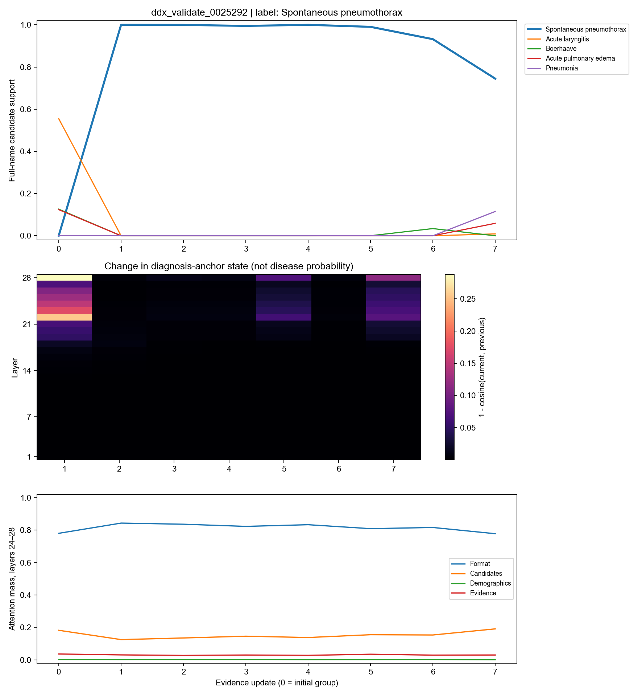

# ddx_validate_0025292

源标签：**Spontaneous pneumothorax**；参考首位：**Spontaneous pneumothorax**。

上图为完整疾病名的候选分数，中图为真实隐藏状态的方向变化，下图为注意力分配。中图颜色不代表某个疾病。

| 轮 | 新证据 | 名称评分首选 | 标签支持 | 贪心续写 |
|---|---|---|---|---|
| 0 | Do you have pain somewhere, related to your reason for consulting? **Yes** Characterize your pain: **heartbreaking; a knife stroke** Do you feel pain somewhere? **side of the chest(R); breast(R); breast(L)** How intense is the pain? **Recorded scale value 7 on the dataset's 0-10 scale; endpoint meanings are unspecified** Does the pain radiate to another location? **nowhere** How precisely is the pain located? **Recorded scale value 2 on the dataset's 0-10 scale; endpoint meanings are unspecified** How fast did the pain appear? **Recorded scale value 6 on the dataset's 0-10 scale; endpoint meanings are unspecified** | Acute laryngitis | 0.0006 | Acute bronchiolitis |
| 1 | Have any of your family members ever had a pneumothorax? **Yes** | Spontaneous pneumothorax | 0.9999 | Spontaneous pneumothorax |
| 2 | Do you have symptoms that are increased with physical exertion but alleviated with rest? **Yes** | Spontaneous pneumothorax | 0.9996 | Spontaneous pneumothorax |
| 3 | Have you traveled out of the country in the last 4 weeks? **No** | Spontaneous pneumothorax | 0.9946 | Spontaneous pneumothorax |
| 4 | Do you have pain that is increased when you breathe in deeply? **Yes** | Spontaneous pneumothorax | 0.9999 | Spontaneous pneumothorax |
| 5 | Are you experiencing shortness of breath or difficulty breathing in a significant way? **Yes** | Spontaneous pneumothorax | 0.9903 | Spontaneous pneumothorax |
| 6 | Do you smoke cigarettes? **Yes** | Spontaneous pneumothorax | 0.9320 | Spontaneous pneumothorax |
| 7 | Have you ever had a spontaneous pneumothorax? **Yes** | Spontaneous pneumothorax | 0.7449 | Acute bronchiolitis |
