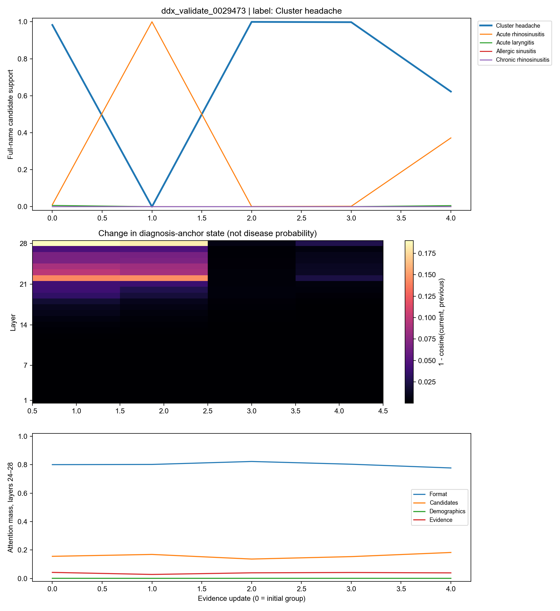

# ddx_validate_0029473

源标签：**Cluster headache**；参考首位：**Cluster headache**。

上图为完整疾病名的候选分数，中图为真实隐藏状态的方向变化，下图为注意力分配。中图颜色不代表某个疾病。

| 轮 | 新证据 | 名称评分首选 | 标签支持 | 贪心续写 |
|---|---|---|---|---|
| 0 | Do you have pain somewhere, related to your reason for consulting? **Yes** Characterize your pain: **haunting; a knife stroke; violent; sharp** Do you feel pain somewhere? **forehead; cheek(R); eye(R); eye(L); temple(R)** How intense is the pain? **Recorded scale value 8 on the dataset's 0-10 scale; endpoint meanings are unspecified** Does the pain radiate to another location? **nowhere** How precisely is the pain located? **Recorded scale value 6 on the dataset's 0-10 scale; endpoint meanings are unspecified** How fast did the pain appear? **Recorded scale value 9 on the dataset's 0-10 scale; endpoint meanings are unspecified** | Cluster headache | 0.9826 | Cluster headache |
| 1 | Do you have nasal congestion or a clear runny nose? **Yes** | Acute rhinosinusitis | 0.0000 | Acute rhinosinusitis |
| 2 | Have any of your family members been diagnosed with cluster headaches? **Yes** | Cluster headache | 0.9992 | Cluster headache |
| 3 | Do you drink alcohol excessively or do you have an addiction to alcohol? **Yes** | Cluster headache | 0.9977 | Cluster headache |
| 4 | Have you traveled out of the country in the last 4 weeks? **No** | Cluster headache | 0.6225 | Cluster headache |
