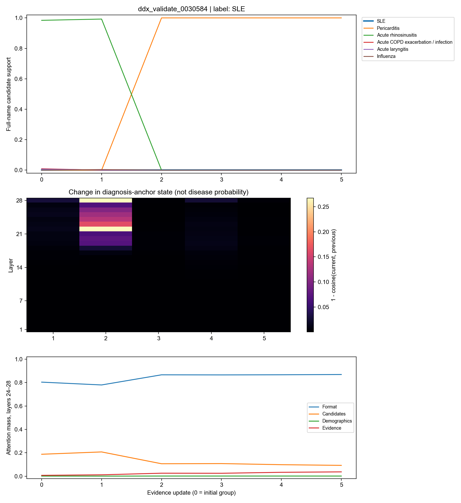

# ddx_validate_0030584

源标签：**SLE**；参考首位：**Possible NSTEMI / STEMI**。

上图为完整疾病名的候选分数，中图为真实隐藏状态的方向变化，下图为注意力分配。中图颜色不代表某个疾病。

| 轮 | 新证据 | 名称评分首选 | 标签支持 | 贪心续写 |
|---|---|---|---|---|
| 0 | Do you have painful mouth ulcers or sores? **Yes** | Acute rhinosinusitis | 0.0000 | Acute rhinosinusitis |
| 1 | Do you constantly feel fatigued or do you have non-restful sleep? **Yes** | Acute rhinosinusitis | 0.0000 | Acute rhinosinusitis |
| 2 | Have you ever had a pericarditis? **Yes** | Pericarditis | 0.0000 | Pericarditis |
| 3 | Have you traveled out of the country in the last 4 weeks? **No** | Pericarditis | 0.0000 | Pericarditis |
| 4 | Do you have any lesions, redness or problems on your skin that you believe are related to the condition you are consulting for? **Yes** What color is the rash? **red** Do your lesions peel off? **No** Is the rash swollen? **Recorded scale value 2 on the dataset's 0-10 scale; endpoint meanings are unspecified** Where is the affected region located? **cheek(R); cheek(L); nose** Is the lesion (or are the lesions) larger than 1cm? **Yes** How severe is the itching? **Recorded scale value 2 on the dataset's 0-10 scale; endpoint meanings are unspecified** | Pericarditis | 0.0000 | Pericarditis |
| 5 | Do you have pain somewhere, related to your reason for consulting? **Yes** Characterize your pain: **sensitive; sharp** Do you feel pain somewhere? **back of the neck; ankle(R); knee(R); shoulder(R); shoulder(L)** How intense is the pain? **Recorded scale value 6 on the dataset's 0-10 scale; endpoint meanings are unspecified** Does the pain radiate to another location? **nowhere** How precisely is the pain located? **Recorded scale value 8 on the dataset's 0-10 scale; endpoint meanings are unspecified** How fast did the pain appear? **Recorded scale value 5 on the dataset's 0-10 scale; endpoint meanings are unspecified** | Pericarditis | 0.0000 | Pericarditis |
