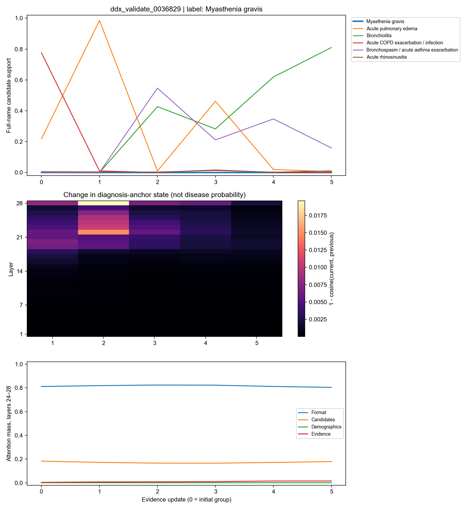

# ddx_validate_0036829

源标签：**Myasthenia gravis**；参考首位：**Myasthenia gravis**。

上图为完整疾病名的候选分数，中图为真实隐藏状态的方向变化，下图为注意力分配。中图颜色不代表某个疾病。

| 轮 | 新证据 | 名称评分首选 | 标签支持 | 贪心续写 |
|---|---|---|---|---|
| 0 | Do you feel weakness in both arms and/or both legs? **Yes** | Acute COPD exacerbation / infection | 0.0000 | Acute COPD exacerbation / infection |
| 1 | Are you experiencing shortness of breath or difficulty breathing in a significant way? **Yes** | Acute pulmonary edema | 0.0000 | Acute bronchiolitis |
| 2 | Do you have difficulty articulating words/speaking? **Yes** | Bronchospasm / acute asthma exacerbation | 0.0000 | Acute bronchiolitis |
| 3 | Do you have difficulty swallowing, or have a feeling of discomfort/blockage when swallowing? **Yes** | Acute pulmonary edema | 0.0000 | Acute bronchiolitis |
| 4 | Do you have the perception of seeing two images of a single object seen overlapping or adjacent to each other (double vision)? **Yes** | Bronchiolitis | 0.0000 | Acute bronchiolitis |
| 5 | Have you traveled out of the country in the last 4 weeks? **No** | Bronchiolitis | 0.0000 | Acute bronchiolitis |
