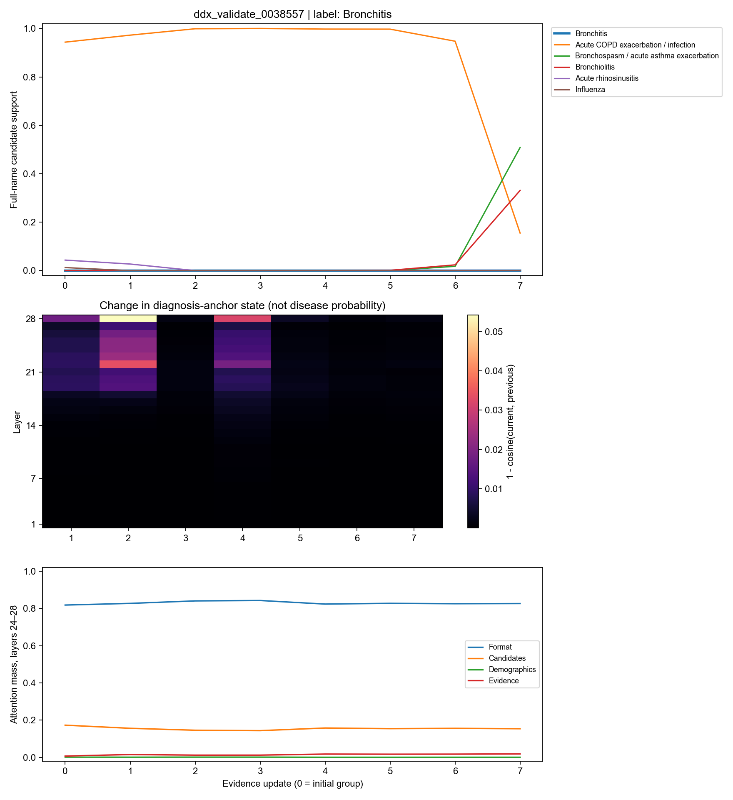

# ddx_validate_0038557

源标签：**Bronchitis**；参考首位：**Acute COPD exacerbation / infection**。

上图为完整疾病名的候选分数，中图为真实隐藏状态的方向变化，下图为注意力分配。中图颜色不代表某个疾病。

| 轮 | 新证据 | 名称评分首选 | 标签支持 | 贪心续写 |
|---|---|---|---|---|
| 0 | Do you have a fever (either felt or measured with a thermometer)? **Yes** | Acute COPD exacerbation / infection | 0.0000 | Acute COPD exacerbation / infection |
| 1 | Are you experiencing shortness of breath or difficulty breathing in a significant way? **Yes** | Acute COPD exacerbation / infection | 0.0000 | Acute COPD exacerbation / infection |
| 2 | Do you have a chronic obstructive pulmonary disease (COPD)? **Yes** | Acute COPD exacerbation / infection | 0.0000 | Acute COPD exacerbation / infection |
| 3 | Have you noticed a wheezing sound when you exhale? **Yes** | Acute COPD exacerbation / infection | 0.0000 | Acute COPD exacerbation / infection |
| 4 | Do you have pain somewhere, related to your reason for consulting? **Yes** Characterize your pain: **sensitive; burning** Do you feel pain somewhere? **side of the chest(R); pharynx; breast(R); posterior chest wall(L)** How intense is the pain? **Recorded scale value 2 on the dataset's 0-10 scale; endpoint meanings are unspecified** Does the pain radiate to another location? **nowhere** How precisely is the pain located? **Recorded scale value 2 on the dataset's 0-10 scale; endpoint meanings are unspecified** How fast did the pain appear? **Recorded scale value 3 on the dataset's 0-10 scale; endpoint meanings are unspecified** | Acute COPD exacerbation / infection | 0.0000 | Acute bronchiolitis |
| 5 | Have you traveled out of the country in the last 4 weeks? **No** | Acute COPD exacerbation / infection | 0.0000 | Acute bronchiolitis |
| 6 | Do you have a cough? **Yes** | Acute COPD exacerbation / infection | 0.0000 | Acute bronchiolitis |
| 7 | Do you have a cough that produces colored or more abundant sputum than usual? **Yes** | Bronchospasm / acute asthma exacerbation | 0.0000 | Acute bronchospasm / acute asthma exacerbation |
