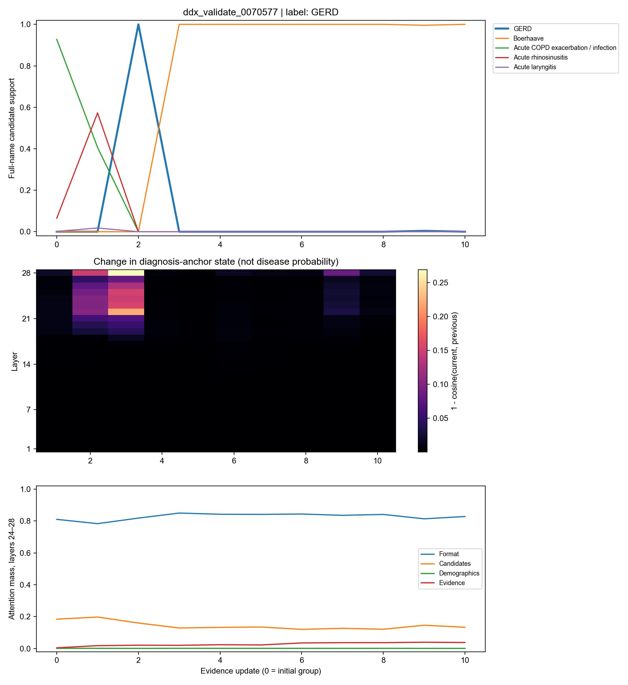

# ddx_validate_0070577

源标签：**GERD**；参考首位：**GERD**。

上图为完整疾病名的候选分数，中图为真实隐藏状态的方向变化，下图为注意力分配。中图颜色不代表某个疾病。

| 轮 | 新证据 | 名称评分首选 | 标签支持 | 贪心续写 |
|---|---|---|---|---|
| 0 | Are your symptoms worse when lying down and alleviated while sitting up? **Yes** | Acute COPD exacerbation / infection | 0.0000 | Acute bronchiolitis |
| 1 | Do you drink alcohol excessively or do you have an addiction to alcohol? **Yes** | Acute rhinosinusitis | 0.0000 | Acute bronchiolitis |
| 2 | Do you have a burning sensation that starts in your stomach then goes up into your throat, and can be associated with a bitter taste in your mouth? **Yes** | GERD | 1.0000 | GERD |
| 3 | Have you recently thrown up blood or something resembling coffee beans? **Yes** | Boerhaave | 0.0000 | Boerhaave |
| 4 | Do you have asthma or have you ever had to use a bronchodilator in the past? **Yes** | Boerhaave | 0.0000 | Boerhaave |
| 5 | Do you have a cough? **Yes** | Boerhaave | 0.0000 | Boerhaave |
| 6 | Do you have pain somewhere, related to your reason for consulting? **Yes** Characterize your pain: **haunting; sensitive; tugging; burning; sickening** Do you feel pain somewhere? **hypochondrium(L); belly; epigastric** How intense is the pain? **Recorded scale value 5 on the dataset's 0-10 scale; endpoint meanings are unspecified** Does the pain radiate to another location? **upper chest** How precisely is the pain located? **Recorded scale value 8 on the dataset's 0-10 scale; endpoint meanings are unspecified** How fast did the pain appear? **Recorded scale value 1 on the dataset's 0-10 scale; endpoint meanings are unspecified** | Boerhaave | 0.0000 | Boerhaave |
| 7 | Do you smoke cigarettes? **Yes** | Boerhaave | 0.0000 | Boerhaave |
| 8 | Do you have symptoms that get worse after eating? **Yes** | Boerhaave | 0.0000 | Boerhaave |
| 9 | Have you traveled out of the country in the last 4 weeks? **No** | Boerhaave | 0.0042 | Boerhaave |
| 10 | Are you significantly overweight compared to people of the same height as you? **Yes** | Boerhaave | 0.0000 | Boerhaave |
