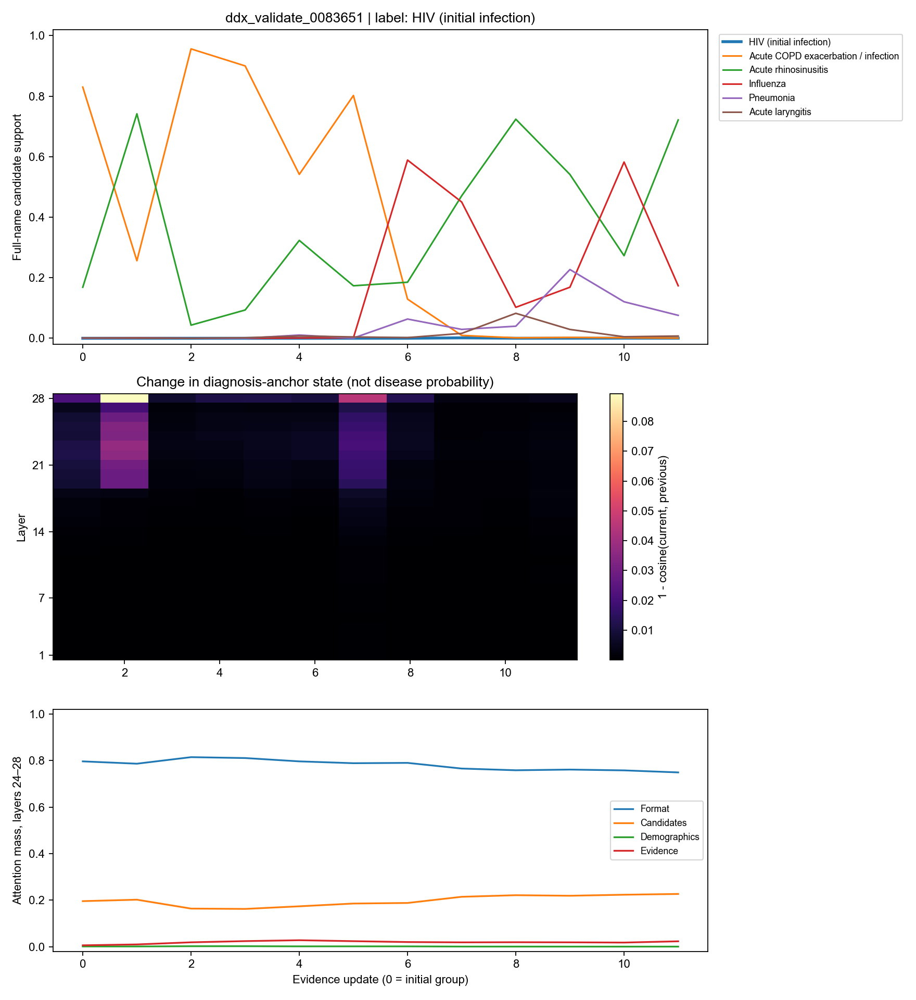

# ddx_validate_0083651

源标签：**HIV (initial infection)**；参考首位：**HIV (initial infection)**。

上图为完整疾病名的候选分数，中图为真实隐藏状态的方向变化，下图为注意力分配。中图颜色不代表某个疾病。

| 轮 | 新证据 | 名称评分首选 | 标签支持 | 贪心续写 |
|---|---|---|---|---|
| 0 | Have you had an involuntary weight loss over the last 3 months? **Yes** | Acute COPD exacerbation / infection | 0.0000 | Acute COPD exacerbation / infection |
| 1 | Have you traveled out of the country in the last 4 weeks? **No** | Acute rhinosinusitis | 0.0000 | Acute rhinosinusitis |
| 2 | Do you feel so tired that you are unable to do your usual activities or are you stuck in your bed all day long? **Yes** | Acute COPD exacerbation / infection | 0.0000 | Acute bronchiolitis |
| 3 | Do you have swollen or painful lymph nodes? **Yes** | Acute COPD exacerbation / infection | 0.0000 | Acute bronchiolitis |
| 4 | Do you have diffuse (widespread) muscle pain? **Yes** | Acute COPD exacerbation / infection | 0.0000 | Acute bronchiolitis |
| 5 | Have you ever had a sexually transmitted infection? **Yes** | Acute COPD exacerbation / infection | 0.0000 | Acute bronchiolitis |
| 6 | Do you have a fever (either felt or measured with a thermometer)? **Yes** | Influenza | 0.0000 | Acute bronchiolitis |
| 7 | Do you have any lesions, redness or problems on your skin that you believe are related to the condition you are consulting for? **Yes** What color is the rash? **pale** Do your lesions peel off? **No** Is the rash swollen? **Recorded scale value 4 on the dataset's 0-10 scale; endpoint meanings are unspecified** Where is the affected region located? **lower gum; upper gum; labia majora(R); labia majora(L); internal cheek(R)** How intense is the pain caused by the rash? **Recorded scale value 5 on the dataset's 0-10 scale; endpoint meanings are unspecified** Is the lesion (or are the lesions) larger than 1cm? **Yes** How severe is the itching? **Recorded scale value 0 on the dataset's 0-10 scale; endpoint meanings are unspecified** | Acute rhinosinusitis | 0.0014 | Acute rhinosinusitis |
| 8 | Are you currently using intravenous drugs? **Yes** | Acute rhinosinusitis | 0.0001 | Acute bronchiolitis |
| 9 | Have you had unprotected sex with more than one partner in the last 6 months? **Yes** | Acute rhinosinusitis | 0.0001 | Acute bronchiolitis |
| 10 | Have you had diarrhea or an increase in stool frequency? **Yes** | Influenza | 0.0004 | Acute bronchiolitis |
| 11 | Do you have pain somewhere, related to your reason for consulting? **Yes** Characterize your pain: **tedious; sensitive; exhausting** Do you feel pain somewhere? **back of the neck; cervical spine; top of the head; forehead; temple(L)** How intense is the pain? **Recorded scale value 5 on the dataset's 0-10 scale; endpoint meanings are unspecified** Does the pain radiate to another location? **nowhere** How precisely is the pain located? **Recorded scale value 4 on the dataset's 0-10 scale; endpoint meanings are unspecified** How fast did the pain appear? **Recorded scale value 4 on the dataset's 0-10 scale; endpoint meanings are unspecified** | Acute rhinosinusitis | 0.0003 | Acute bronchiolitis |
