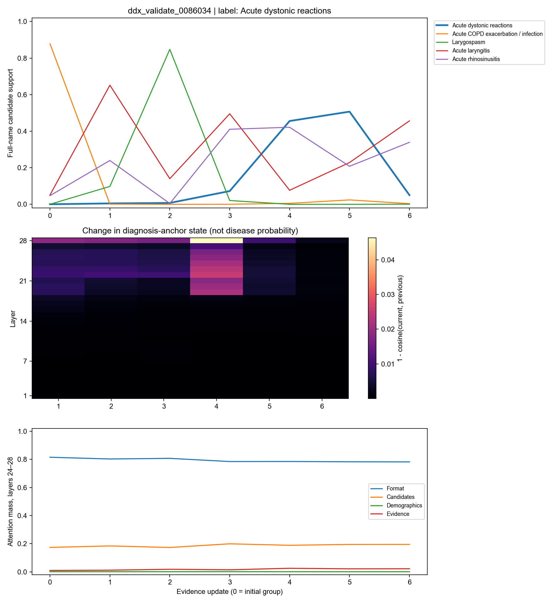

# ddx_validate_0086034

源标签：**Acute dystonic reactions**；参考首位：**Acute dystonic reactions**。

上图为完整疾病名的候选分数，中图为真实隐藏状态的方向变化，下图为注意力分配。中图颜色不代表某个疾病。

| 轮 | 新证据 | 名称评分首选 | 标签支持 | 贪心续写 |
|---|---|---|---|---|
| 0 | Are you unable to control the direction of your eyes? **Yes** | Acute COPD exacerbation / infection | 0.0004 | Acute bronchiolitis |
| 1 | Do you have trouble keeping your tongue in your mouth? **Yes** | Acute laryngitis | 0.0049 | Acute bronchiolitis |
| 2 | Do you feel that muscle spasms or soreness in your neck are keeping you from turning your head to one side? **Yes** | Larygospasm | 0.0075 | Larygospasm |
| 3 | Have you traveled out of the country in the last 4 weeks? **No** | Acute laryngitis | 0.0724 | Acute bronchiolitis |
| 4 | Do you regularly take stimulant drugs? **Yes** | Acute dystonic reactions | 0.4556 | Acute bronchiolitis |
| 5 | Have you ever felt like you were suffocating for a very short time associated with inability to breathe or speak? **Yes** | Acute dystonic reactions | 0.5069 | Acute bronchiolitis |
| 6 | Do you have annoying muscle spasms in your face, neck or any other part of your body? **Yes** | Acute laryngitis | 0.0504 | Acute bronchiolitis |
