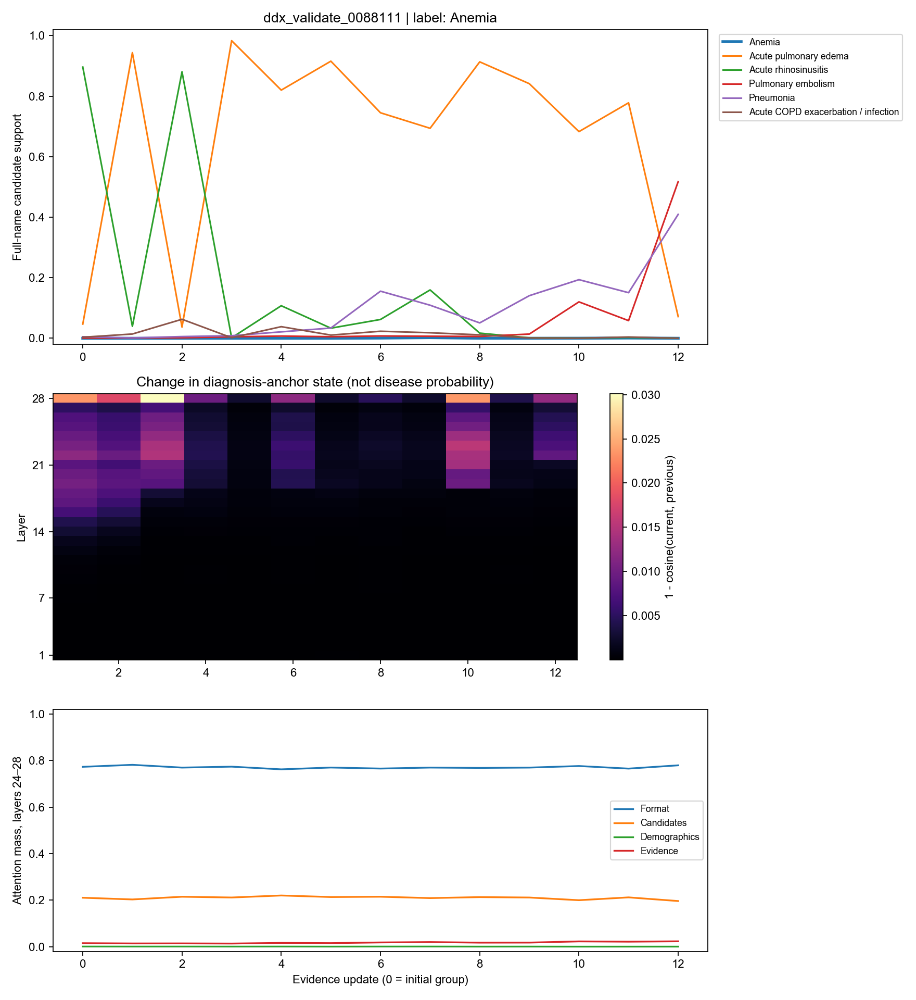

# ddx_validate_0088111

源标签：**Anemia**；参考首位：**Anemia**。

上图为完整疾病名的候选分数，中图为真实隐藏状态的方向变化，下图为注意力分配。中图颜色不代表某个疾病。

| 轮 | 新证据 | 名称评分首选 | 标签支持 | 贪心续写 |
|---|---|---|---|---|
| 0 | Do you have pain somewhere, related to your reason for consulting? **Yes** Characterize your pain: **sensitive; tugging; exhausting** Do you feel pain somewhere? **back of head; temple(L)** How intense is the pain? **Recorded scale value 1 on the dataset's 0-10 scale; endpoint meanings are unspecified** Does the pain radiate to another location? **nowhere** How precisely is the pain located? **Recorded scale value 6 on the dataset's 0-10 scale; endpoint meanings are unspecified** How fast did the pain appear? **Recorded scale value 5 on the dataset's 0-10 scale; endpoint meanings are unspecified** | Acute rhinosinusitis | 0.0000 | Acute bronchiolitis |
| 1 | Do you feel lightheaded and dizzy or do you feel like you are about to faint? **Yes** | Acute pulmonary edema | 0.0000 | Acute pulmonary edema |
| 2 | Have you traveled out of the country in the last 4 weeks? **No** | Acute rhinosinusitis | 0.0000 | Acute bronchiolitis |
| 3 | Do you have chronic kidney failure? **Yes** | Acute pulmonary edema | 0.0000 | Acute pulmonary edema |
| 4 | Do you think you are pregnant or are you currently pregnant? **Yes** | Acute pulmonary edema | 0.0000 | Acute pulmonary edema |
| 5 | Do you feel slightly dizzy or lightheaded? **Yes** | Acute pulmonary edema | 0.0000 | Acute pulmonary edema |
| 6 | Do you feel so tired that you are unable to do your usual activities or are you stuck in your bed all day long? **Yes** | Acute pulmonary edema | 0.0007 | Acute pulmonary edema |
| 7 | Do you have a poor diet? **Yes** | Acute pulmonary edema | 0.0020 | Acute bronchiolitis |
| 8 | Are you taking any new oral anticoagulants ((NOACs)? **Yes** | Acute pulmonary edema | 0.0002 | Acute pulmonary edema |
| 9 | Is your skin much paler than usual? **Yes** | Acute pulmonary edema | 0.0001 | Acute pulmonary edema |
| 10 | Have you recently had stools that were black (like coal)? **Yes** | Acute pulmonary edema | 0.0002 | Acute pulmonary edema |
| 11 | Is your BMI less than 18.5, or are you underweight? **Yes** | Acute pulmonary edema | 0.0009 | Acute pulmonary edema |
| 12 | Have you noticed light red blood or blood clots in your stool? **Yes** | Pulmonary embolism | 0.0000 | Pulmonary embolism |
