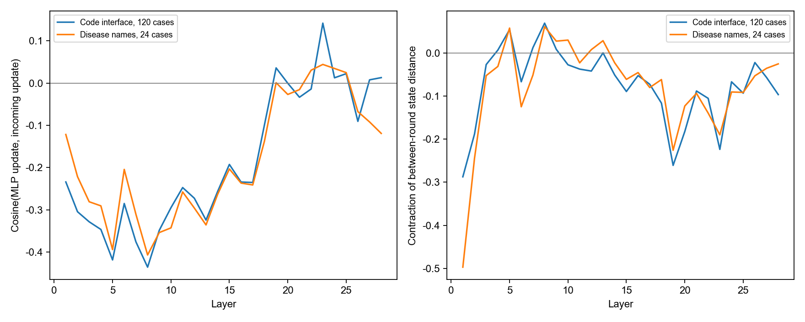

# 补充：MLP在放大还是抵消新旧状态之间的差异

观察到阶段08层方向模式后追加的探索性分析。对固定中间轮，测量进入MLP前、经过MLP后的新旧轮状态距离。收缩量为1减去后/前距离比；正值是拉近、负值是拉远。它是整个隐藏向量的几何量，不是某个疾病的概率。

| 层 | 编码接口120例收缩量 [95%区间] | 名称接口24例收缩量 [95%区间] |
|---|---|---|
| 26 | -0.0225 [-0.0274, -0.0175] | -0.0533 [-0.0691, -0.0376] |
| 27 | -0.0572 [-0.0624, -0.0520] | -0.0359 [-0.0485, -0.0242] |
| 28 | -0.0968 [-0.1044, -0.0892] | -0.0256 [-0.0396, -0.0106] |

**两个接口的第26—28层平均都扩大了新旧状态的欧氏距离，区间均不跨0。因此，编码实验中的干预方向翻转不能用“26/27层整体收缩、28层整体放大”这个简单解释说明。应进一步测量疾病相关方向，而非只看变化幅度。**

该量检验“MLP抵消前面部分状态改变”是否与干预结果相容。即使存在收缩，也不能只凭范数认定其压制或增强某种医学信念；疾病方向需要结合未见病例读出及因果诊断变化。

[逐病例数据](component_geometry.csv) · [汇总](component_geometry_summary.json)
