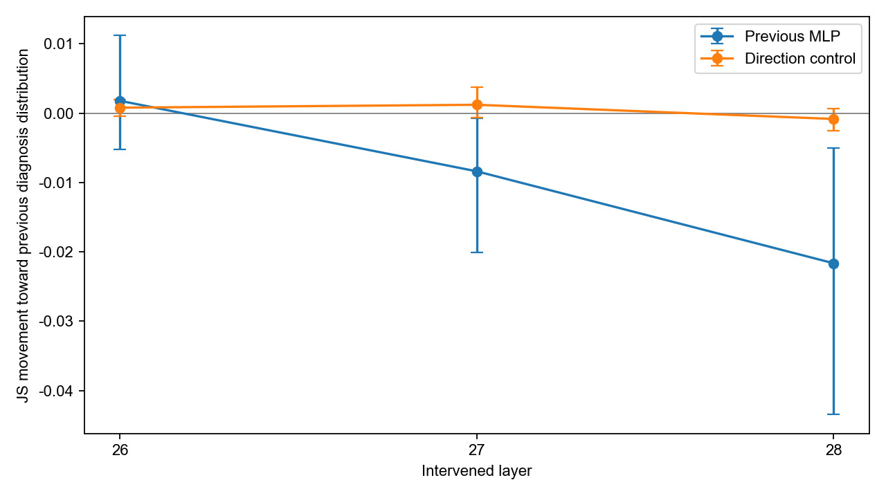

# 阶段10：疾病全名输出下的内部干预

## 方法

固定24例的中间轮，在第26、27、28层，将诊断位置的MLP增量换为同病例上一轮增量。另以同范数、循环移位257维的差向量作方向对照。修改后完整重算下游前缀缓存，并对49个完整疾病名续写评分；不只看首字或字母。每病例另做自身替换数值检查。

主要量为最终分布向上一轮分布靠近的JS差；正值靠近，负值远离。病例为统计单位，2000次bootstrap区间。本阶段为探索性跨接口复查，24例的疾病覆盖不均，不将它称为独立总体确认。

## 结果

| 层 | 旧MLP替换效应 [95%区间] | 减去方向对照 [95%区间] | 恢复前轮首选 / 原本切换病例 | 方向对照恢复 |
|---|---|---|---|---|
| 26 | 0.0018 [-0.0052, 0.0112] | 0.0010 [-0.0058, 0.0098] | 0/7 | 0/7 |
| 27 | -0.0084 [-0.0201, -0.0008] | -0.0096 [-0.0210, -0.0017] | 0/7 | 0/7 |
| 28 | -0.0216 [-0.0434, -0.0050] | -0.0208 [-0.0427, -0.0047] | 0/7 | 0/7 |

24例中24例通过自身替换检查；最大分布JS误差0.00000000。全部原始条件保留，未通过者不进入效应统计。

**完整疾病名输出下，第28层旧MLP替换平均让分布进一步远离前轮，而不是拉回前轮。** 为排除样本集合不同，取完全相同24例比较：第28层相对方向对照效应在编码接口为0.0172 [0.0070, 0.0288]，名称接口为-0.0208 [-0.0427, -0.0047]；病例配对差为0.0380 [0.0171, 0.0614]。七例原本发生首选切换的病例中，没有一例因此恢复旧首选。

因此，“第28层旧MLP携带可以直接恢复的旧医学诊断”不是本轮支持的通用解释。旧模块输出与当前上下文组合后的作用，依赖输出任务。此比较包含列表呈现、答案形式和自回归路径的整体差异，不单独归因为一个字符。

## 医学内容与普通新增文字

在同一24例前轮输入后，追加真实新证据的疾病分布JS改变量为0.1674 [0.0730, 0.2687]，行政说明为0.0696 [0.0189, 0.1329]，重复初始证据为0.1102 [0.0375, 0.1958]。真实减行政的病例配对差为0.0978 [0.0165, 0.1979]，真实减重复的差为0.0572 [-0.0427, 0.1657]。三条件平均新增token分别为41.0、34.0、48.6；不是长度匹配对照。

第28层改用“前轮+行政说明”的MLP作为来源，向前轮靠近量为-0.0071 [-0.0278, 0.0096]。它使用不同提示下的自然状态作为来源，与精确旧前缀的替换结果并列阅读。

## 解释

该实验直接回答：**内部这一块计算变回旧状态后，模型对完整疾病名的判断会不会被拉回去？** 效应方向和区间见表，不以期望方向替代结果。当前轮输入仍保留新证据，因此变化来自受控内部替换。前轮可能对也可能错；“拉回去”不等于“诊断改善”。

第28层锚点MLP替换直接改变第一个输出token的分布；完整疾病名剩余token仍在完整模型中评分。第26/27层还会改变下游锚点缓存。两者的传播路径不同，不以数值差异直接宣称高低层具备相反医学知识。

[每病例的前轮、当前、干预疾病与分数](case_interventions.csv) · [精确结果](summary.json)

[同24例跨接口配对](matched_interface_effects.csv) · [为什么整体变化幅度解释不了方向翻转](GEOMETRY.md)
