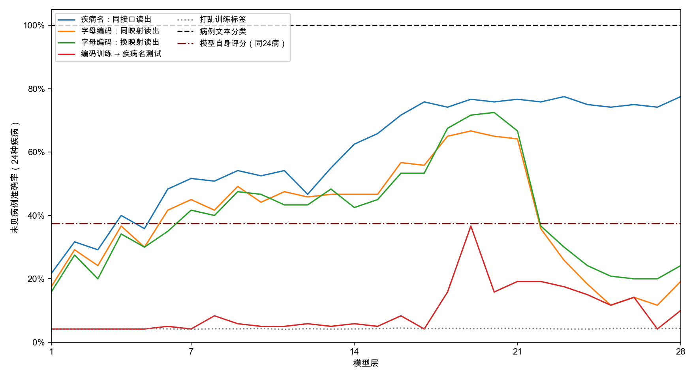
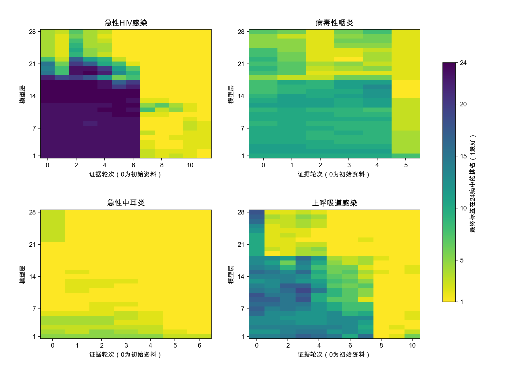

# 阶段11：从未见患者的内部状态识别疾病

## 问题与设计

**模型内部到底有没有能用于识别疾病的信息？** 用其他患者训练简单线性读出器，再测试未见患者。120例、24病种各5例，按病种固定五折：每折96例训练、24例测试。同一患者所有轮次和接口始终隔离。目标为源疾病标签，不是模型自己的最终输出。

每层诊断位置状态先逐向量L2归一化、按训练均值中心化，岭分类器主正则0.1；0.01和1另作敏感性检查。病例文本基线用原始问答TF-IDF与线性分类，词表只在训练患者拟合，不含候选列表。100次训练标签置换作为负对照。所有模型和数据均冻结；本阶段训练的是外部读出器。

## 结果

| 层 | 名称→名称 | 编码0→编码0 | 编码0→编码16 | 编码0→名称 |
|---|---|---|---|---|
| 7 | 51.67% [42.50, 60.83] | 45.00% [36.67, 53.33] | 41.67% [32.50, 50.00] | 4.17% [0.83, 8.33] |
| 14 | 62.50% [53.33, 70.83] | 46.67% [37.50, 55.83] | 42.50% [34.17, 51.67] | 5.83% [2.50, 10.00] |
| 21 | 76.67% [69.17, 84.17] | 64.17% [55.83, 72.50] | 66.67% [58.33, 75.00] | 19.17% [12.50, 26.67] |
| 28 | 77.50% [70.00, 85.00] | 19.17% [12.50, 25.85] | 24.17% [16.67, 31.67] | 10.00% [5.00, 15.83] |

原始病例文本分类准确率：100.00% [96.97, 100.00]。模型名称评分在相同24类中的准确率：37.50% [28.33, 45.83]。名称第28层读出减去该模型输出基线的配对差为40.00% [30.00, 50.00]，减去文本基线的差为-22.50% [-30.00, -15.00]。

探索性最高名称读出准确率出现在第23层，为77.5%；按28层最大值与100次标签置换比较，p=0.0099。正文优先使用预定的第7/14/21/28层，最高层不作为事先选定结果。

## 从终点读出回到逐轮轨迹

将每折只用其他患者终点训练的读出器，应用于同一折深描病例的每一轮，得到每层的疾病排序。下图展示预先哈希排序中的前4例；完整24例读出数据均保留。排名1表示外部线性读出器可以把源标签排在首位，不等于模型此时作出了该诊断。

在固定24例全部轮次上，先病例内平均，第21层读出标签命中为52.97% [38.50, 66.74]，同24类的模型名称评分为26.81% [14.38, 39.47]，文本分类基线为91.43% [84.98, 96.53]。第21层读出比模型评分更早把最终标签排首位的病例比例为50.00% [29.17, 70.83]，更晚的为12.50% [0.00, 25.00]。这衡量标签信息可读出的时间，不给中间轮制造医学标准答案。

## 解释

这个实验区分“内部状态能否提供疾病信息”和“模型最终选了什么”。读出器可能从表示中重新学会诊断规则，尤其当文本基线也能很好分类时；不能仅凭高读出准确率说模型早已知道答案。跨未见患者、跨编码或接口的迁移，决定可读出信息是否稳定。模型实际使用什么，仍由阶段10的内部干预判断。

区间为固定五折预测上的病例bootstrap，不含重新训练的不确定性。24类读出只与同24类的模型评分直接比较；49候选结果在阶段09单列。

[逐患者预测](heldout_case_predictions.csv) · [逐层逐轮疾病排名](heldout_trajectory_readouts.csv) · [精确结果与正则敏感性](summary.json)

## 文本可分性的追加审计

独立复算确认完整问答120/120，问题文字单独输入120/120，仅证据ID117/120；完整输入及忽略人口信息后的事实集合均无跨折完全重复。年龄性别单独输入1/120。说明这批病例的症状记录结构高度可分，不能把外部读出准确率直接当成模型医学理解。详见[审计](TEXT_AUDIT.md)。

首次命中时间表中的T+1（T为最后实际轮次）表示全程未命中，不是一个实际发生的轮次。报告的“读出更早”包括读出已经命中而模型全程未命中的病例。[相反更新的全体统计](OPPOSITE_UPDATES.md)单列严格交叉事件，不把一个例子当成总体规律。
