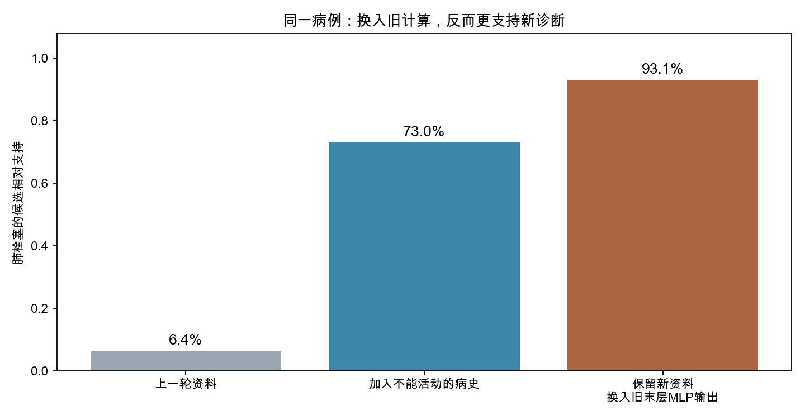
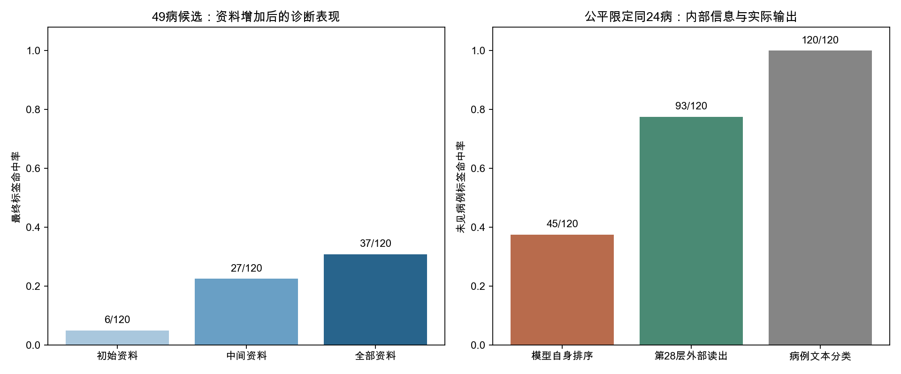

# 医学信念研究：阶段06—11综合结果

**本轮最清楚的结果：模型内部含有可以识别疾病的信息，但它没有同样可靠地把这些信息变成诊断。另一个反直觉结果是：把旧计算放进新上下文，有时反而会加强新诊断。**

本轮完成120个新增模拟病例、24病种、6个疾病组；Qwen3-1.7B，28层、16个注意力头。本机M2 Pro GPU，收费API调用为0。所有实验参数冻结；每轮重新输入累计证据，未把前轮答案喂回。研究的是证据增加后的内部状态与判断变化。

## 1. 先看一个能理解的例子

病例`ddx_validate_0000493`：77岁女性，数据集的最终疾病标签为**肺栓塞**。

模型已看过前几组资料时，更偏向急性肺水肿。新增一条病史：**过去四周内，曾连续三天以上不能活动或起身。** 模型随即转向肺栓塞。

然后做内部实验：新证据仍保留，只将第28层诊断位置的MLP输出换成上一轮对应的数值。MLP是层内的一块计算，不是一个单独的疾病标签。

| 条件 | 肺栓塞的相对支持 | 当时首选 |
|---|---|---|
| 上一轮资料 | 6.35% | 急性肺水肿 |
| 加入新病史 | 73.01% | 肺栓塞 |
| 保留新病史，换入旧末层MLP输出 | 93.09% | 肺栓塞 |

**换回旧计算，没有恢复旧诊断，反而加强了新诊断。** 这说明一块旧模块输出的作用取决于它与当前状态怎样组合；不能直接把它当成保存着“旧疾病”的容器。该例是说明，下面的总体统计才用于判断规律。

这例后面也没有一直保持正确：第5轮加入胸部疼痛的细节后，模型转向Boerhaave（食管破裂），到终点仍未命中肺栓塞标签。与此同时，第21层外部读出给肺栓塞的排名由第20升到第1。这种“读出由错转对、模型由对转错”的严格交叉，在固定24例178次更新中只出现于1例，作为线索保留，不作为总体规律。[全体相反更新统计](../11_disease_information/OPPOSITE_UPDATES.md)

[该病例每轮证据、疾病支持和内部状态](../09_disease_name_trajectories/cases/ddx_validate_0000493.md)

## 2. 全体病例是否随着证据接近最终疾病

使用49个完整疾病名评分，120例的标签命中为：**初始6例 → 中间27例 → 最终37例**。总体确有改善，但最终仍有83例没有把源标签排在首位。

固定24例的完整轨迹中，**7例曾命中标签又偏离**。相同完整事实仅将新增证据逆序，**12/24例首选改变**；独立乱序改变9/24例。仅反转候选列表也改变12/24例，因此不能将所有摇摆都归因于医学信息本身。

真正的新证据使疾病分布产生的改变量，平均大于行政说明：病例配对JS差为0.0978 [0.0165, 0.1979]。二者是自然措辞、未严格等长；重复已知证据同样可能引起变化。[详细轨迹与对照](../09_disease_name_trajectories/RESULTS.md)

## 3. 内部到底测到了什么

我们增加了一个外部线性读出器：只用其他病例训练，再从未见病例的层内状态识别疾病。同一病例的所有轮次都留在同一测试折，避免背题。

为了公平比较，将读出器和模型自身评分都限定到同样24种受试疾病：

| 方法 | 识别正确的病例 |
|---|---|
| 模型自己的疾病名排序 | **45/120，37.5%** |
| 从第21层状态读出 | **92/120，76.7%** |
| 从第28层状态读出 | **93/120，77.5%** |
| 直接用病例文本训练分类器 | **120/120，100%** |

第28层读出与模型自身排序的病例配对差为**40个百分点**，95%区间[30,50]。在24例完整轨迹中，有12例第21层读出已首次命中时，模型自身排序尚未命中过最终标签；3例相反。这里包括模型全程未命中的病例，不为它们虚构一次后来的命中。

**可以下的判断：内部状态保留了可用于区分疾病的信息，最终诊断没有稳定利用这些可读信息。** 但读出器是在其他病例上学习了“状态→疾病”的映射，高分不等于模型原先就按同样方式理解或使用这些信息。

文本基线的100%已独立复核：仅问题文字仍为120/120，仅证据ID为117/120；没有跨折完全重复的病例事实集合。这里“记录了哪些问题”本身携带了症状集合信息。这批模拟病例的标签结构很容易被外部分类器识别，后续必须固定问诊结构，进一步检验对答案内容的处理。

[内部疾病信息报告](../11_disease_information/RESULTS.md) · [文本基线审计](../11_disease_information/TEXT_AUDIT.md)

## 4. 旧的层间机制解释怎样修改

编码实验的120例确认了旧模式：换入上一轮MLP输出，第26、27层平均让最终分布远离旧分布，第28层让它靠近。

但改用完整疾病名后，**第28层的方向反过来了**。这不是仅由病例不同造成：取完全相同24例，第28层相对方向对照效应为：

| 输出设置 | 向旧判断靠近量 [95%区间] |
|---|---|
| 字母编码，两编码在病例内平均 | 0.0172 [0.0070, 0.0288] |
| 完整疾病名 | -0.0208 [-0.0427, -0.0047] |

正数表示拉向旧分布，负数表示进一步远离。两个设置的病例配对差为0.0380 [0.0171, 0.0614]。疾病名条件下，7例原本发生首选切换的病例，没有一例因该替换恢复旧首选。

**因此收回“末层MLP保存着能直接恢复的旧医学信念”这一解释。当前支持的是：同一类内部计算对诊断的作用，依赖当前上下文和输出任务。** 输出设置同时改变列表形式、答案形式和自回归路径；下一步要分解这些作用。

补充检查发现，两接口第26—28层都扩大了新旧状态的整体距离。因此，“某层只是在把变化变小”也解释不了诊断方向的翻转，后续必须测疾病相关方向。

[内部干预](../10_name_causal_mechanism/RESULTS.md) · [状态变化幅度检查](../10_name_causal_mechanism/GEOMETRY.md)

## 5. 每层、注意力与真值如何使用

每个观测点保存28层的进入状态、注意力贡献、注意力后状态、MLP贡献、离层状态；每层16个头分别记录它对各组证据的注意力。固定24例另保存逐token注意力、各头输出及证据末位置状态。**变的是计算出来的状态，模型权重没有在这些轮次中重新训练。**

注意力到某个位置不等于那个位置贡献了多少医学信息：模板位置的状态也可能已整合前文。疾病名阶段，晚层状态方向变化与疾病分布改变量的病例内相关系数平均为0.639，95%区间[0.523,0.742]；这提供对应关系，不能代替干预。

120例都有源疾病标签，91例的标签同时也是源参考鉴别分布的首位。49候选完整覆盖参考分布。中间轮没有独立医学标准答案，因此“偏离”指偏离最终标签，不把每次中途改诊都自动叫作医学错误。

## 6. 本轮阶段交付

| 阶段 | 完成内容 | 结果 |
|---|---|---|
| 06 | 120例、49候选、5040个编码观测点，基础与逆序全轨迹 | [报告](../06_full_candidate_trajectories/RESULTS.md) |
| 07 | 28层、16头的状态与证据注意力 | [报告](../07_attention_and_layers/RESULTS.md) |
| 08 | 240个固定中间轮/编码条件，1200个前缀×层干预记录 | [报告](../08_causal_confirmation/RESULTS.md) |
| 09 | 538个完整病名观测点；120例三节点、24例完整轨迹 | [报告](../09_disease_name_trajectories/RESULTS.md) |
| 10 | 24例完整病名干预、内容和候选列表控制、跨接口配对 | [报告](../10_name_causal_mechanism/RESULTS.md) |
| 11 | 120例五折真实疾病读出、跨接口测试、标签置换、文本审计 | [报告](../11_disease_information/RESULTS.md) |

[120例编码轨迹](../06_full_candidate_trajectories/CASE_ATLAS.md) · [24例病名深描](../09_disease_name_trajectories/CASE_ATLAS.md) · [逐层逐轮疾病排名](../11_disease_information/heldout_trajectory_readouts.csv)

## 7. 论文主线与下一阶段

**主问题收敛为：医学证据进入模型后，哪些疾病信息被保留下来，哪些信息真正参与了诊断，二者为什么会分开？**

下一阶段优先做两件事：固定问诊问题与展示顺序，只改变已知答案的揭示；再用独立病例学到的疾病方向做定向干预，测它是否选择性改变对应疾病的完整名称支持。这样才能从“状态能读出来”走到“医学信息被怎样使用”。模型规模和先前诊断历史随后扩展。

当前发现已经把内部可读信息、实际诊断与局部计算作用分开测量。论文的创新性继续以具体可重复机制为依据，不因使用了探针或激活替换就宣称首次发现。

[更新后的ACL主线](../../acl_paper/01_STORY.md) · [下一阶段判据](../../acl_paper/04_NEXT_DECISIONS.md) · [复现步骤](../../protocol/FULL49_REPRODUCE.md)

## 交付核验

5578个新观测文件全量核验通过；五折读出的24例前缀分数独立重算通过；156张PNG与156份PDF已生成，内部链接检查通过。[核验记录](../../protocol/FULL49_DELIVERY_VERIFICATION.json)。
