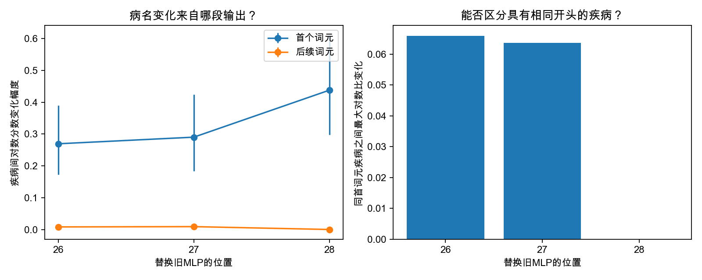

# 阶段13：最后一层改变的是疾病，还是病名开头？

## 方法

对阶段10固定24例完整病名、旧MLP替换结果作事后分解，不重新选择病例。每个疾病的完整序列对数概率等于首个词元与后续词元对数概率之和。干预前后相减后，分别统计两部分在49个疾病之间的变化（先减疾病平均值，去掉共同归一化偏移）。另比较首词元相同疾病之间的相对分数，排除仅改变病名开头的效应。

## 结果

| 层 | 首词元变化幅度 | 后续词元变化幅度 | 同首词元疾病的最大相对变化 |
|---|---|---|---|
| 26 | 0.2694 [0.1728, 0.3895] | 0.0081 [0.0059, 0.0106] | 0.0659 [0.0481, 0.0873] |
| 27 | 0.2902 [0.1843, 0.4242] | 0.0090 [0.0063, 0.0124] | 0.0637 [0.0438, 0.0921] |
| 28 | 0.4380 [0.2980, 0.6106] | 0.00（样本内全零） | 0.00（样本内全零） |

## 机制解释

在最后一层、回答前的最后一个位置替换MLP，只改变接下来第一个词元的分数。该层的KV缓存已经由替换前的输入生成；没有更晚的层可以将这一变化写入新的KV缓存。因此，在固定同一个候选病名的教师强制续写中，后续词元分数不因这次替换而改变。第26/27层则仍可经过后面的层影响缓存。

这项架构事实解释了为什么“最后一层干预能改变病名概率”本身不是选择性操纵疾病表征的证据。共享首词元的疾病可一起升降，但它们之间的相对支持不变。先前末层干预效果仍是真实计算效应，其解释应收窄为对诊断输出入口的作用。

下一阶段使用独立病例训练的疾病方向，同时比较第21/28层、仅锚点/续写过程，并单独检验同首词元疾病的区分。表中数字按病例bootstrap，未作为事先假设检验。

[逐病例分解](case_decomposition.csv) · [精确汇总](summary.json)
