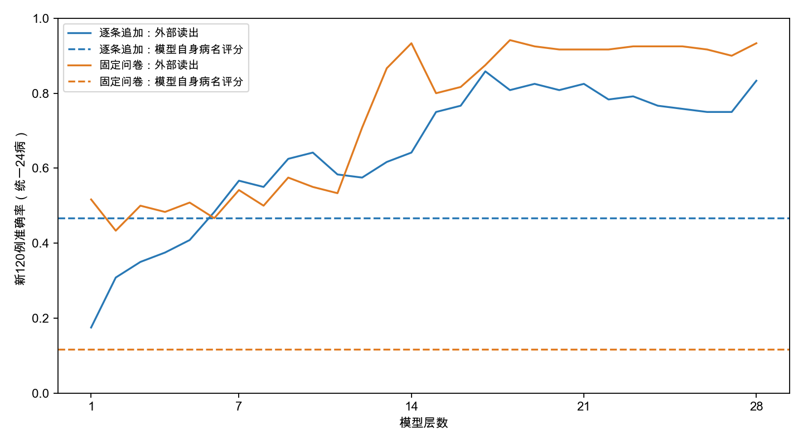

# 阶段14：在新病例与固定问卷中追踪医学判断

## 方法

旧120例训练，新120例独立测试；24病种各5例，6疾病组。测试来自DDxPlus另一数据划分，与旧病例无完全相同事实集合，但仍属同一模拟生成来源。预定24例追踪全部轮次。固定问卷包含公开字典全部223个字段，已知值按源记录填写，缺失保持未知。与相同病例的原追加式提示配对；固定问卷同时改变长度、位置和未知信息展示，效果不能单独归因于某一因素。

## 终点表现

| 呈现 | 模型49病 | 模型限制24病 | 第21层24病读出 | 第28层24病读出 |
|---|---|---|---|---|
| 逐条追加 | 36.67% [28.33, 45.83] | 46.67% [37.50, 55.00] | 82.50% [75.00, 89.17] | 83.33% [76.67, 90.00] |
| 固定问卷 | 8.33% [4.17, 13.33] | 11.67% [6.67, 17.50] | 91.67% [86.67, 96.67] | 93.33% [88.33, 97.50] |

读出器仅在旧120例上训练，模型参数冻结；alpha=.1，所有28层均报告。区间为固定训练头后的测试病例bootstrap，不含训练集重采样不确定性。

## 每条证据如何改变判断

| 呈现 | 新增证据次数 | 首选改变次数 | 任一病分数变化≥50个百分点 | 曾命中标签后偏离的病例比例 |
|---|---:|---:|---:|---|
| append | 184 | 77 | 69 | 45.83% [25.00, 66.67] |
| panel | 184 | 23 | 21 | 20.83% [4.17, 37.50] |

这里的分数是49条完整病名序列之间的相对支持，不是患者患病概率。最终标签不是每轮标准答案；新增证据也不必使标签支持单调增加。内部热图是独立读出器排名，不能解释为各层的校准疾病概率。

## 内容与呈现对照

固定问卷与追加式终点首选不同：87.50% [81.67, 93.33]。追加式相同事实逆序后首选改变：37.50% [20.83, 54.17]；乱序：25.00% [8.33, 41.67]。

24例终点只保留哪些答案已记录、删去具体值后，模型49病命中：0.00% [0.00, 14.25]；相对完整问卷首选改变：29.17% [12.50, 50.00]。固定问题并未去掉“哪些答案已知”的信息，这个对照用于识别记录结构的残留影响。单独的文本基线继续保留在附表，不把高分类准确率当成复杂医学推理。

## 交付

[24例完整轨迹与证据](CASE_ATLAS.md) · [终点逐病例](endpoint_cases.csv) · [每次证据更新](evidence_updates.csv) · [逐轮读出](prefix_trajectories.csv) · [注意力观察](attention_summary.csv) · [精确汇总](summary.json)
