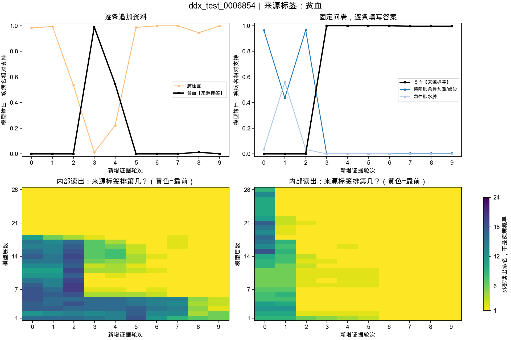

# ddx_test_0006854

源标签：Anemia。来源：DDxPlus test 第6854行（零起始）。

- 第0轮：Have you noticed light red blood or blood clots in your stool? **Yes**
- 第1轮：Do you have chronic kidney failure? **Yes**
- 第2轮：Do you have pain somewhere, related to your reason for consulting? **Yes**；Characterize your pain: **sensitive; a cramp**；Do you feel pain somewhere? **back of head; temple(R)**；How intense is the pain? **Recorded scale value 5 on the dataset's 0-10 scale; endpoint meanings are unspecified**；Does the pain radiate to another location? **nowhere**；How precisely is the pain located? **Recorded scale value 8 on the dataset's 0-10 scale; endpoint meanings are unspecified**；How fast did the pain appear? **Recorded scale value 4 on the dataset's 0-10 scale; endpoint meanings are unspecified**
- 第3轮：Have you ever had a diagnosis of anemia? **Yes**
- 第4轮：Is your BMI less than 18.5, or are you underweight? **Yes**
- 第5轮：Have you recently had stools that were black (like coal)? **Yes**
- 第6轮：Have you traveled out of the country in the last 4 weeks? **South Africa**
- 第7轮：Do you have a poor diet? **Yes**
- 第8轮：Do you have any family members who have been diagnosed with anemia? **Yes**
- 第9轮：Are you taking any new oral anticoagulants ((NOACs)? **Yes**

| 条件 | 轮 | 模型首选 | 标签支持 | 第21层读出首选 | 标签读出排名 |
|---|---|---|---:|---|---:|
| append | 0 | Pulmonary embolism | 0.0000 | Anemia | 1 |
| append | 1 | Pulmonary embolism | 0.0000 | Anemia | 1 |
| append | 2 | Pulmonary embolism | 0.0000 | Anemia | 1 |
| append | 3 | Anemia | 0.9896 | Anemia | 1 |
| append | 4 | Anemia | 0.5457 | Anemia | 1 |
| append | 5 | Pulmonary embolism | 0.0000 | Anemia | 1 |
| append | 6 | Pulmonary embolism | 0.0000 | Anemia | 1 |
| append | 7 | Pulmonary embolism | 0.0000 | Anemia | 1 |
| append | 8 | Pulmonary embolism | 0.0129 | Anemia | 1 |
| append | 9 | Pulmonary embolism | 0.0000 | Anemia | 1 |
| panel | 0 | Acute COPD exacerbation / infection | 0.0000 | Pancreatic neoplasm | 17 |
| panel | 1 | Acute pulmonary edema | 0.0000 | Pancreatic neoplasm | 3 |
| panel | 2 | Acute COPD exacerbation / infection | 0.0000 | Pulmonary embolism | 2 |
| panel | 3 | Anemia | 1.0000 | Anemia | 1 |
| panel | 4 | Anemia | 1.0000 | Anemia | 1 |
| panel | 5 | Anemia | 1.0000 | Anemia | 1 |
| panel | 6 | Anemia | 1.0000 | Anemia | 1 |
| panel | 7 | Anemia | 0.9957 | Anemia | 1 |
| panel | 8 | Anemia | 0.9957 | Anemia | 1 |
| panel | 9 | Anemia | 0.9957 | Anemia | 1 |

## 图怎么读

上排看模型实际更支持哪种病，黑线是来源标签；下排看每层内部状态经独立训练的读出器后，来源标签排第几，黄色更靠前。两张图测量的对象不同，下排不代表模型自己报出的概率。

- 逐条追加终点：模型输出首选**肺栓塞**；第28层外部读出首选**贫血**。
- 固定问卷终点：模型输出首选**贫血**；第28层外部读出首选**贫血**。
