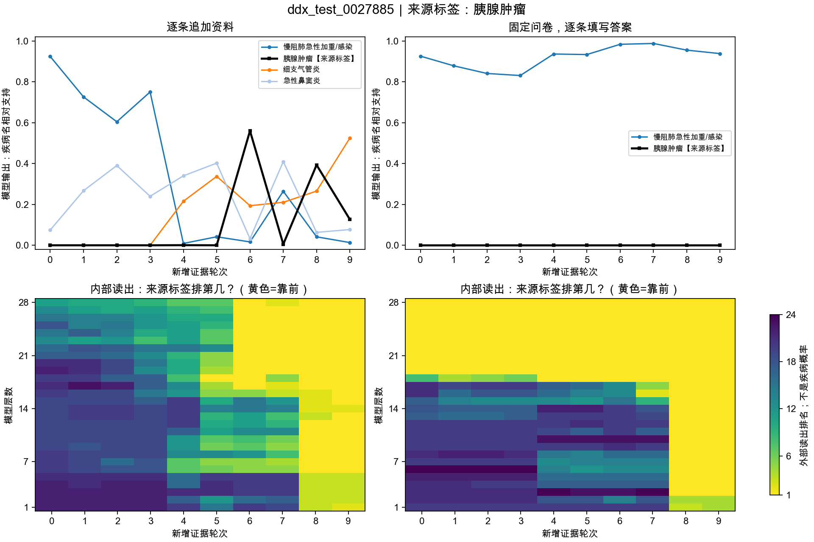

# ddx_test_0027885

源标签：Pancreatic neoplasm。来源：DDxPlus test 第27885行（零起始）。

- 第0轮：Have you had diarrhea or an increase in stool frequency? **Yes**
- 第1轮：Do you have diabetes? **Yes**
- 第2轮：Have you traveled out of the country in the last 4 weeks? **No**
- 第3轮：Are you significantly overweight compared to people of the same height as you? **Yes**
- 第4轮：Do you have pain somewhere, related to your reason for consulting? **Yes**；Characterize your pain: **a cramp**；Do you feel pain somewhere? **flank(L); epigastric**；How intense is the pain? **Recorded scale value 1 on the dataset's 0-10 scale; endpoint meanings are unspecified**；Does the pain radiate to another location? **nowhere**；How precisely is the pain located? **Recorded scale value 1 on the dataset's 0-10 scale; endpoint meanings are unspecified**；How fast did the pain appear? **Recorded scale value 5 on the dataset's 0-10 scale; endpoint meanings are unspecified**
- 第5轮：Do you smoke cigarettes? **Yes**
- 第6轮：Do you have chronic pancreatitis? **Yes**
- 第7轮：Do you have a cough? **Yes**
- 第8轮：Do you have any lesions, redness or problems on your skin that you believe are related to the condition you are consulting for? **Yes**；What color is the rash? **yellow**；Do your lesions peel off? **No**；Is the rash swollen? **Recorded scale value 0 on the dataset's 0-10 scale; endpoint meanings are unspecified**；Where is the affected region located? **epigastric**；How intense is the pain caused by the rash? **Recorded scale value 2 on the dataset's 0-10 scale; endpoint meanings are unspecified**；Is the lesion (or are the lesions) larger than 1cm? **Yes**；How severe is the itching? **Recorded scale value 3 on the dataset's 0-10 scale; endpoint meanings are unspecified**
- 第9轮：Have you had an involuntary weight loss over the last 3 months? **Yes**

| 条件 | 轮 | 模型首选 | 标签支持 | 第21层读出首选 | 标签读出排名 |
|---|---|---|---:|---|---:|
| append | 0 | Acute COPD exacerbation / infection | 0.0000 | Acute otitis media | 17 |
| append | 1 | Acute COPD exacerbation / infection | 0.0000 | Bronchitis | 17 |
| append | 2 | Acute COPD exacerbation / infection | 0.0000 | Bronchitis | 16 |
| append | 3 | Acute COPD exacerbation / infection | 0.0000 | Atrial fibrillation | 13 |
| append | 4 | Acute rhinosinusitis | 0.0006 | Inguinal hernia | 9 |
| append | 5 | Acute rhinosinusitis | 0.0001 | Inguinal hernia | 5 |
| append | 6 | Pancreatic neoplasm | 0.5602 | Pancreatic neoplasm | 1 |
| append | 7 | Acute rhinosinusitis | 0.0052 | Pancreatic neoplasm | 1 |
| append | 8 | Pancreatic neoplasm | 0.3933 | Pancreatic neoplasm | 1 |
| append | 9 | Bronchiolitis | 0.1266 | Pancreatic neoplasm | 1 |
| panel | 0 | Acute COPD exacerbation / infection | 0.0000 | Pancreatic neoplasm | 1 |
| panel | 1 | Acute COPD exacerbation / infection | 0.0000 | Pancreatic neoplasm | 1 |
| panel | 2 | Acute COPD exacerbation / infection | 0.0000 | Pancreatic neoplasm | 1 |
| panel | 3 | Acute COPD exacerbation / infection | 0.0000 | Pancreatic neoplasm | 1 |
| panel | 4 | Acute COPD exacerbation / infection | 0.0000 | Pancreatic neoplasm | 1 |
| panel | 5 | Acute COPD exacerbation / infection | 0.0000 | Pancreatic neoplasm | 1 |
| panel | 6 | Acute COPD exacerbation / infection | 0.0000 | Pancreatic neoplasm | 1 |
| panel | 7 | Acute COPD exacerbation / infection | 0.0000 | Pancreatic neoplasm | 1 |
| panel | 8 | Acute COPD exacerbation / infection | 0.0000 | Pancreatic neoplasm | 1 |
| panel | 9 | Acute COPD exacerbation / infection | 0.0000 | Pancreatic neoplasm | 1 |

## 图怎么读

上排看模型实际更支持哪种病，黑线是来源标签；下排看每层内部状态经独立训练的读出器后，来源标签排第几，黄色更靠前。两张图测量的对象不同，下排不代表模型自己报出的概率。

- 逐条追加终点：模型输出首选**细支气管炎**；第28层外部读出首选**胰腺肿瘤**。
- 固定问卷终点：模型输出首选**慢阻肺急性加重/感染**；第28层外部读出首选**胰腺肿瘤**。
