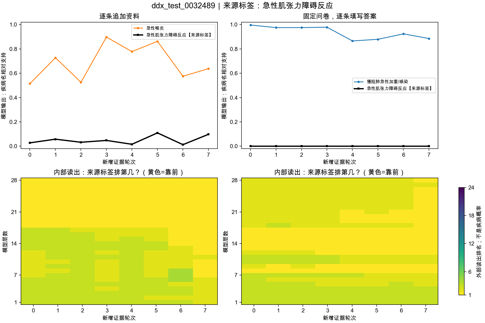

# ddx_test_0032489

源标签：Acute dystonic reactions。来源：DDxPlus test 第32489行（零起始）。

- 第0轮：Do you feel that muscle spasms or soreness in your neck are keeping you from turning your head to one side? **Yes**
- 第1轮：Do you have a hard time opening/raising one or both eyelids? **Yes**
- 第2轮：Do you regularly take stimulant drugs? **Yes**
- 第3轮：Do you suddenly have difficulty or an inability to open your mouth or have jaw pain when opening it? **Yes**
- 第4轮：Have you ever felt like you were suffocating for a very short time associated with inability to breathe or speak? **Yes**
- 第5轮：Do you have trouble keeping your tongue in your mouth? **Yes**
- 第6轮：Have you traveled out of the country in the last 4 weeks? **No**
- 第7轮：Have you been treated in hospital recently for nausea, agitation, intoxication or aggressive behavior and received medication via an intravenous or intramuscular route? **Yes**

| 条件 | 轮 | 模型首选 | 标签支持 | 第21层读出首选 | 标签读出排名 |
|---|---|---|---:|---|---:|
| append | 0 | Acute laryngitis | 0.0277 | Acute dystonic reactions | 1 |
| append | 1 | Acute laryngitis | 0.0579 | Acute dystonic reactions | 1 |
| append | 2 | Acute laryngitis | 0.0326 | Acute dystonic reactions | 1 |
| append | 3 | Acute laryngitis | 0.0475 | Acute dystonic reactions | 1 |
| append | 4 | Acute laryngitis | 0.0159 | Acute dystonic reactions | 1 |
| append | 5 | Acute laryngitis | 0.1095 | Acute dystonic reactions | 1 |
| append | 6 | Acute laryngitis | 0.0127 | Acute dystonic reactions | 1 |
| append | 7 | Acute laryngitis | 0.0977 | Acute dystonic reactions | 1 |
| panel | 0 | Acute COPD exacerbation / infection | 0.0001 | Myasthenia gravis | 2 |
| panel | 1 | Acute COPD exacerbation / infection | 0.0000 | Myasthenia gravis | 2 |
| panel | 2 | Acute COPD exacerbation / infection | 0.0001 | Myasthenia gravis | 2 |
| panel | 3 | Acute COPD exacerbation / infection | 0.0001 | Myasthenia gravis | 2 |
| panel | 4 | Acute COPD exacerbation / infection | 0.0001 | Acute dystonic reactions | 1 |
| panel | 5 | Acute COPD exacerbation / infection | 0.0001 | Myasthenia gravis | 2 |
| panel | 6 | Acute COPD exacerbation / infection | 0.0001 | Acute dystonic reactions | 1 |
| panel | 7 | Acute COPD exacerbation / infection | 0.0000 | Acute dystonic reactions | 1 |

## 图怎么读

上排看模型实际更支持哪种病，黑线是来源标签；下排看每层内部状态经独立训练的读出器后，来源标签排第几，黄色更靠前。两张图测量的对象不同，下排不代表模型自己报出的概率。

- 逐条追加终点：模型输出首选**急性喉炎**；第28层外部读出首选**急性肌张力障碍反应**。
- 固定问卷终点：模型输出首选**慢阻肺急性加重/感染**；第28层外部读出首选**急性肌张力障碍反应**。
