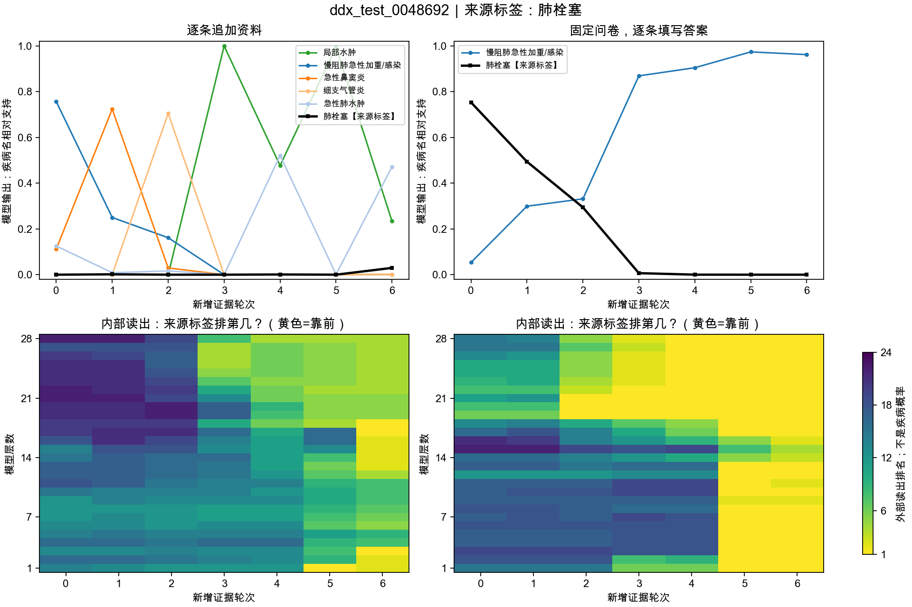

# ddx_test_0048692

源标签：Pulmonary embolism。来源：DDxPlus test 第48692行（零起始）。

- 第0轮：Do you have pain that is increased when you breathe in deeply? **Yes**
- 第1轮：Have you traveled out of the country in the last 4 weeks? **No**
- 第2轮：Have you been coughing up blood? **Yes**
- 第3轮：Do you have swelling in one or more areas of your body? **Yes**；Where is the swelling located? **posterior aspect of the ankle(R); posterior aspect of the ankle(L)**
- 第4轮：Did you lose consciousness? **Yes**
- 第5轮：Do you have pain somewhere, related to your reason for consulting? **Yes**；Characterize your pain: **sharp**；Do you feel pain somewhere? **side of the chest(R); side of the chest(L); scapula(R); scapula(L); posterior chest wall(R)**；How intense is the pain? **Recorded scale value 1 on the dataset's 0-10 scale; endpoint meanings are unspecified**；Does the pain radiate to another location? **side of the chest(L); upper chest; scapula(R); breast(R); posterior chest wall(L)**；How precisely is the pain located? **Recorded scale value 9 on the dataset's 0-10 scale; endpoint meanings are unspecified**；How fast did the pain appear? **Recorded scale value 3 on the dataset's 0-10 scale; endpoint meanings are unspecified**
- 第6轮：Have you ever had deep vein thrombosis (DVT)? **Yes**

| 条件 | 轮 | 模型首选 | 标签支持 | 第21层读出首选 | 标签读出排名 |
|---|---|---|---:|---|---:|
| append | 0 | Acute COPD exacerbation / infection | 0.0000 | Bronchitis | 22 |
| append | 1 | Acute rhinosinusitis | 0.0016 | URTI | 22 |
| append | 2 | Bronchiolitis | 0.0001 | Anemia | 19 |
| append | 3 | Localized edema | 0.0000 | Acute pulmonary edema | 13 |
| append | 4 | Acute pulmonary edema | 0.0009 | Acute pulmonary edema | 6 |
| append | 5 | Localized edema | 0.0001 | Acute pulmonary edema | 5 |
| append | 6 | Acute pulmonary edema | 0.0297 | Inguinal hernia | 5 |
| panel | 0 | Pulmonary embolism | 0.7534 | Inguinal hernia | 11 |
| panel | 1 | Pulmonary embolism | 0.4941 | Inguinal hernia | 12 |
| panel | 2 | Acute COPD exacerbation / infection | 0.2943 | Pulmonary embolism | 1 |
| panel | 3 | Acute COPD exacerbation / infection | 0.0067 | Pulmonary embolism | 1 |
| panel | 4 | Acute COPD exacerbation / infection | 0.0002 | Pulmonary embolism | 1 |
| panel | 5 | Acute COPD exacerbation / infection | 0.0000 | Pulmonary embolism | 1 |
| panel | 6 | Acute COPD exacerbation / infection | 0.0000 | Pulmonary embolism | 1 |

## 图怎么读

上排看模型实际更支持哪种病，黑线是来源标签；下排看每层内部状态经独立训练的读出器后，来源标签排第几，黄色更靠前。两张图测量的对象不同，下排不代表模型自己报出的概率。

- 逐条追加终点：模型输出首选**急性肺水肿**；第28层外部读出首选**自发性气胸**。
- 固定问卷终点：模型输出首选**慢阻肺急性加重/感染**；第28层外部读出首选**肺栓塞**。
